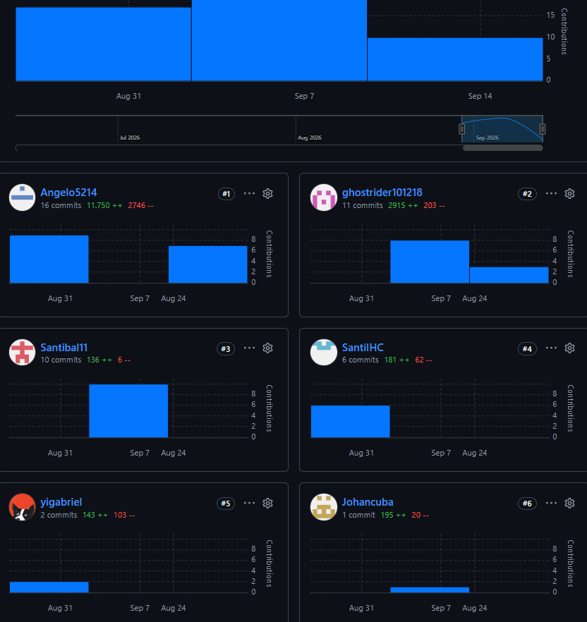
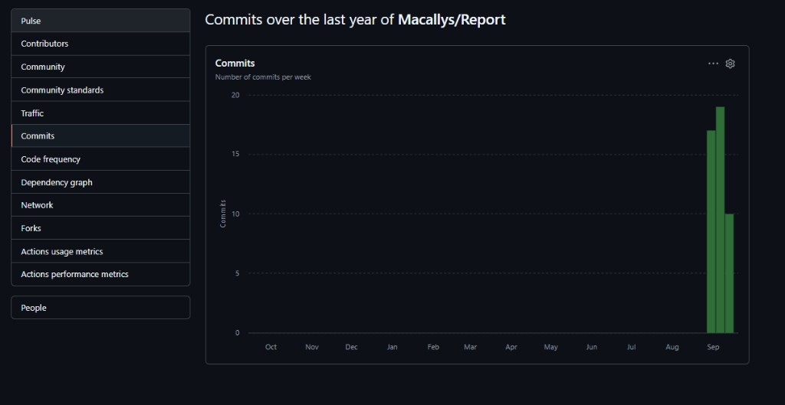
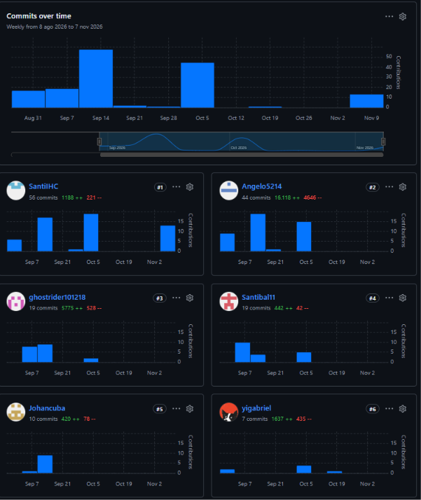
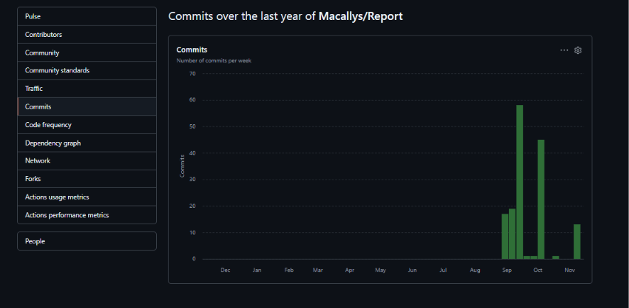

**Navegación:** [Índice](./informe.md#s-tabla-contenidos) · Siguiente: [Capítulo I](./01-capitulo-i-introduccion.md)

---

**Universidad Peruana de Ciencias Aplicadas**

**Carrera de Ingeniería de Software**

**1ASI0572**

**Desarrollo de Soluciones IoT**

**NRC**

8729

**Informe del Trabajo Final**

**Docente**

León Baca, Marco Antonio

**Equipo**

Macallys

**Proyecto**

SafePlant

**Integrantes**

<table align="center">
  <thead>
    <tr>
      <th align="center">Código</th>
      <th align="center">Apellidos y Nombres</th>
    </tr>
  </thead>
  <tbody>
    <tr>
      <td align="center">U20231B775</td>
      <td align="center">Solano Armas, Angelo Héctor</td>
    </tr>
    <tr>
      <td align="center">U202215160</td>
      <td align="center">Gordillo Ramos, Santiago Alonso</td>
    </tr>
    <tr>
      <td align="center">U202417448</td>
      <td align="center">Huaman Cuba, Johan Giovani</td>
    </tr>
    <tr>
      <td align="center">U202319881</td>
      <td align="center">Baldeon Vivar, Santiago Armando</td>
    </tr>
    <tr>
      <td align="center">U202316118</td>
      <td align="center">Iglesias Pérez, Sergio Sebastián</td>
    </tr>
    <tr>
      <td align="center">U202310609</td>
      <td align="center">Sanchez Gonzales, Gabriel</td>
    </tr>
  </tbody>
</table>

**Período**

202620

# Registro de Versiones del Informe

<table>
  <thead>
    <tr>
      <th align="left">Versión</th>
      <th align="left">Fecha</th>
      <th align="left">Autor</th>
      <th align="left">Descripción de modificación</th>
    </tr>
  </thead>
  <tbody>
    <tr>
      <td align="left">1.1</td>
      <td align="left">2026-08-31</td>
      <td align="left">Equipo Macallys</td>
      <td align="left">Inicialización del esqueleto del informe según el enunciado del Trabajo Final.</td>
    </tr>
    <tr>
      <td align="left">1.2</td>
      <td align="left">2026-09-01</td>
      <td align="left">Gordillo Ramos, Santiago Alonso</td>
      <td align="left">Creación del Startup Profile de Macallys.</td>
    </tr>
    <tr>
      <td align="left">1.3</td>
      <td align="left">2026-09-02</td>
      <td align="left">Gordillo Ramos, Santiago Alonso</td>
      <td align="left">Redacción de la descripción de la startup.</td>
    </tr>
    <tr>
      <td align="left">1.4</td>
      <td align="left">2026-09-03</td>
      <td align="left">Gordillo Ramos, Santiago Alonso</td>
      <td align="left">Elaboración del Solution Profile.</td>
    </tr>
    <tr>
      <td align="left">1.5</td>
      <td align="left">2026-09-04</td>
      <td align="left">Gordillo Ramos, Santiago Alonso</td>
      <td align="left">Definición de Lean UX Problem Statements.</td>
    </tr>
    <tr>
      <td align="left">1.6</td>
      <td align="left">2026-09-05</td>
      <td align="left">Gordillo Ramos, Santiago Alonso</td>
      <td align="left">Definición de Lean UX Assumptions.</td>
    </tr>
    <tr>
      <td align="left">1.7</td>
      <td align="left">2026-09-06</td>
      <td align="left">Gordillo Ramos, Santiago Alonso</td>
      <td align="left">Redacción de Lean UX Hypothesis Statements y Lean UX Canvas.</td>
    </tr>
    <tr>
      <td align="left">1.8</td>
      <td align="left">2026-09-07</td>
      <td align="left">Gordillo Ramos, Santiago Alonso</td>
      <td align="left">Definición de los segmentos objetivo.</td>
    </tr>
    <tr>
      <td align="left">1.9</td>
      <td align="left">2026-09-08</td>
      <td align="left">Sanchez Gonzales, Gabriel</td>
      <td align="left">Diseño de entrevistas.</td>
    </tr>
    <tr>
      <td align="left">1.10</td>
      <td align="left">2026-09-09</td>
      <td align="left">Gordillo Ramos, Santiago Alonso</td>
      <td align="left">Registro de entrevistas.</td>
    </tr>
    <tr>
      <td align="left">1.11</td>
      <td align="left">2026-09-10</td>
      <td align="left">Solano Armas, Angelo Héctor</td>
      <td align="left">Participación en entrevistas.</td>
    </tr>
    <tr>
      <td align="left">1.12</td>
      <td align="left">2026-09-11</td>
      <td align="left">Huaman Cuba, Johan Giovani</td>
      <td align="left">Participación en entrevistas.</td>
    </tr>
    <tr>
      <td align="left">1.13</td>
      <td align="left">2026-09-12</td>
      <td align="left">Sanchez Gonzales, Gabriel</td>
      <td align="left">Participación en entrevistas.</td>
    </tr>
    <tr>
      <td align="left">1.14</td>
      <td align="left">2026-09-13</td>
      <td align="left">Baldeon Vivar, Santiago Armando</td>
      <td align="left">Análisis competitivo.</td>
    </tr>
    <tr>
      <td align="left">1.15</td>
      <td align="left">2026-09-14</td>
      <td align="left">Baldeon Vivar, Santiago Armando</td>
      <td align="left">Definición de estrategias y tácticas frente a competidores.</td>
    </tr>
    <tr>
      <td align="left">1.16</td>
      <td align="left">2026-09-15</td>
      <td align="left">Baldeon Vivar, Santiago Armando</td>
      <td align="left">Elaboración de Needfinding.</td>
    </tr>
    <tr>
      <td align="left">1.17</td>
      <td align="left">2026-09-16</td>
      <td align="left">Baldeon Vivar, Santiago Armando</td>
      <td align="left">Construcción de User Task Matrix.</td>
    </tr>
    <tr>
      <td align="left">1.18</td>
      <td align="left">2026-09-17</td>
      <td align="left">Gordillo Ramos, Santiago Alonso</td>
      <td align="left">Aporte a Big Picture EventStorming.</td>
    </tr>
    <tr>
      <td align="left">1.19</td>
      <td align="left">2026-09-18</td>
      <td align="left">Solano Armas, Angelo Héctor</td>
      <td align="left">Aporte a Big Picture EventStorming.</td>
    </tr>
    <tr>
      <td align="left">1.20</td>
      <td align="left">2026-09-19</td>
      <td align="left">Huaman Cuba, Johan Giovani</td>
      <td align="left">Aporte a Big Picture EventStorming.</td>
    </tr>
    <tr>
      <td align="left">1.21</td>
      <td align="left">2026-09-20</td>
      <td align="left">Baldeon Vivar, Santiago Armando</td>
      <td align="left">Aporte a Big Picture EventStorming.</td>
    </tr>
    <tr>
      <td align="left">1.22</td>
      <td align="left">2026-09-21</td>
      <td align="left">Iglesias Pérez, Sergio Sebastián</td>
      <td align="left">Aporte a Big Picture EventStorming.</td>
    </tr>
    <tr>
      <td align="left">1.23</td>
      <td align="left">2026-09-22</td>
      <td align="left">Sanchez Gonzales, Gabriel</td>
      <td align="left">Aporte a Big Picture EventStorming.</td>
    </tr>
    <tr>
      <td align="left">1.24</td>
      <td align="left">2026-09-23</td>
      <td align="left">Solano Armas, Angelo Héctor</td>
      <td align="left">Elaboración de User Stories.</td>
    </tr>
    <tr>
      <td align="left">1.25</td>
      <td align="left">2026-09-24</td>
      <td align="left">Sanchez Gonzales, Gabriel</td>
      <td align="left">Elaboración de User Stories.</td>
    </tr>
    <tr>
      <td align="left">1.26</td>
      <td align="left">2026-09-25</td>
      <td align="left">Solano Armas, Angelo Héctor</td>
      <td align="left">Actualización del Product Backlog.</td>
    </tr>
    <tr>
      <td align="left">1.27</td>
      <td align="left">2026-09-26</td>
      <td align="left">Sanchez Gonzales, Gabriel</td>
      <td align="left">Elaboración de Impact Mapping.</td>
    </tr>
    <tr>
      <td align="left">1.28</td>
      <td align="left">2026-09-27</td>
      <td align="left">Solano Armas, Angelo Héctor</td>
      <td align="left">Modelado de Domain Message Flows.</td>
    </tr>
    <tr>
      <td align="left">1.29</td>
      <td align="left">2026-09-28</td>
      <td align="left">Huaman Cuba, Johan Giovani</td>
      <td align="left">Modelado de Domain Message Flows.</td>
    </tr>
    <tr>
      <td align="left">1.30</td>
      <td align="left">2026-09-29</td>
      <td align="left">Sanchez Gonzales, Gabriel</td>
      <td align="left">Modelado de Domain Message Flows.</td>
    </tr>
    <tr>
      <td align="left">1.31</td>
      <td align="left">2026-09-30</td>
      <td align="left">Huaman Cuba, Johan Giovani</td>
      <td align="left">Candidate Context Discovery.</td>
    </tr>
    <tr>
      <td align="left">1.32</td>
      <td align="left">2026-10-01</td>
      <td align="left">Huaman Cuba, Johan Giovani</td>
      <td align="left">Design-Level EventStorming.</td>
    </tr>
    <tr>
      <td align="left">1.33</td>
      <td align="left">2026-10-02</td>
      <td align="left">Iglesias Pérez, Sergio Sebastián</td>
      <td align="left">Definición de Software Architecture.</td>
    </tr>
    <tr>
      <td align="left">1.34</td>
      <td align="left">2026-10-03</td>
      <td align="left">Iglesias Pérez, Sergio Sebastián</td>
      <td align="left">Elaboración del Software Architecture System Landscape Diagram.</td>
    </tr>
    <tr>
      <td align="left">1.35</td>
      <td align="left">2026-10-04</td>
      <td align="left">Iglesias Pérez, Sergio Sebastián</td>
      <td align="left">Tactical-Level Domain-Driven Design.</td>
    </tr>
    <tr>
      <td align="left">1.36</td>
      <td align="left">2026-10-05</td>
      <td align="left">Iglesias Pérez, Sergio Sebastián</td>
      <td align="left">Elaboración de Software Architecture Context Level Diagrams.</td>
    </tr>
    </tr>
    <tr>
      <td align="left">2.1</td>
      <td align="left">2026-10-05</td>
      <td align="left">Iglesias Pérez, Sergio Sebastián</td>
      <td align="left">Elaboración de Software Architecture Container Level Diagrams y Deployment Diagrams (C4).</td>
    </tr>
    <tr>
      <td align="left">2.2</td>
      <td align="left">2026-10-05</td>
      <td align="left">Huaman Cuba, Johan Giovani</td>
      <td align="left">Documentación táctica del Bounded Context Plant Monitoring (capas, componentes y código).</td>
    </tr>
    <tr>
      <td align="left">2.3</td>
      <td align="left">2026-10-05</td>
      <td align="left">Huaman Cuba, Johan Giovani</td>
      <td align="left">Documentación táctica del Bounded Context Safety &amp; Actuation.</td>
    </tr>
    <tr>
      <td align="left">2.4</td>
      <td align="left">2026-10-06</td>
      <td align="left">Iglesias Pérez, Sergio Sebastián</td>
      <td align="left">Documentación táctica del Bounded Context Device &amp; Edge Management.</td>
    </tr>
    <tr>
      <td align="left">2.5</td>
      <td align="left">2026-10-06</td>
      <td align="left">Iglesias Pérez, Sergio Sebastián</td>
      <td align="left">Documentación táctica del Bounded Context Identity &amp; Access.</td>
    </tr>
    <tr>
      <td align="left">2.6</td>
      <td align="left">2026-10-06</td>
      <td align="left">Gordillo Ramos, Santiago Alonso</td>
      <td align="left">Elaboración de General Style Guidelines y Web, Mobile and IoT Style Guidelines.</td>
    </tr>
    <tr>
      <td align="left">2.7</td>
      <td align="left">2026-10-06</td>
      <td align="left">Baldeon Vivar, Santiago Armando</td>
      <td align="left">Definición de Information Architecture: organización, etiquetado, SEO, búsqueda y navegación.</td>
    </tr>
    <tr>
      <td align="left">2.8</td>
      <td align="left">2026-10-06</td>
      <td align="left">Sanchez Gonzales, Gabriel</td>
      <td align="left">Diseño de Landing Page Wireframe y Mock-up (escritorio y móvil).</td>
    </tr>
    <tr>
      <td align="left">2.9</td>
      <td align="left">2026-10-07</td>
      <td align="left">Baldeon Vivar, Santiago Armando</td>
      <td align="left">Elaboración de Applications Wireframes (web del Encargado de Planta y móvil del Supervisor).</td>
    </tr>
    <tr>
      <td align="left">2.10</td>
      <td align="left">2026-10-07</td>
      <td align="left">Solano Armas, Angelo Héctor</td>
      <td align="left">Elaboración de Applications Wireflow Diagrams y User Flow Diagrams.</td>
    </tr>
    <tr>
      <td align="left">2.11</td>
      <td align="left">2026-10-07</td>
      <td align="left">Gordillo Ramos, Santiago Alonso</td>
      <td align="left">Elaboración de Applications Mock-ups y criterios de prototipado.</td>
    </tr>
    <tr>
      <td align="left">2.12</td>
      <td align="left">2026-10-07</td>
      <td align="left">Gordillo Ramos, Santiago Alonso</td>
      <td align="left">Documentación de prototipos web de escritorio y móvil.</td>
    </tr>
    <tr>
      <td align="left">2.13</td>
      <td align="left">2026-10-07</td>
      <td align="left">Baldeon Vivar, Santiago Armando</td>
      <td align="left">Diseño del dispositivo IoT (nodo ESP32, sensores y actuadores; evidencia Wokwi).</td>
    </tr>
    <tr>
      <td align="left">2.14</td>
      <td align="left">2026-10-07</td>
      <td align="left">Gordillo Ramos, Santiago Alonso</td>
      <td align="left">Documentación de Software Configuration Management: entorno de desarrollo, SCM, convenciones y despliegue.</td>
    </tr>
    <tr>
      <td align="left">2.15</td>
      <td align="left">2026-10-07</td>
      <td align="left">Sanchez Gonzales, Gabriel</td>
      <td align="left">Sprint Planning 1, Aspect Leaders and Collaborators y Sprint Backlog 1.</td>
    </tr>
    <tr>
      <td align="left">2.16</td>
      <td align="left">2026-10-07</td>
      <td align="left">Sanchez Gonzales, Gabriel</td>
      <td align="left">Implementación y despliegue de la landing page (US01, US02, US05, US09).</td>
    </tr>
    <tr>
      <td align="left">2.17</td>
      <td align="left">2026-10-07</td>
      <td align="left">Sanchez Gonzales, Gabriel</td>
      <td align="left">Implementación de vistas web: sign-in, dashboard, historial y directorio de cuentas (US08, US11, US12, US23).</td>
    </tr>
    <tr>
      <td align="left">2.18</td>
      <td align="left">2026-10-07</td>
      <td align="left">Iglesias Pérez, Sergio Sebastián</td>
      <td align="left">Configuración del cliente Angular y despliegue de la aplicación web en Vercel.</td>
    </tr>
    <tr>
      <td align="left">2.19</td>
      <td align="left">2026-10-08</td>
      <td align="left">Iglesias Pérez, Sergio Sebastián</td>
      <td align="left">Implementación del backend Identity &amp; Access (JWT, cuentas, OpenAPI) y despliegue en Azure App Service (TS21).</td>
    </tr>
    <tr>
      <td align="left">2.20</td>
      <td align="left">2026-10-08</td>
      <td align="left">Huaman Cuba, Johan Giovani</td>
      <td align="left">Registro de evidencias de desarrollo, ejecución, servicios y despliegue del Sprint 1.</td>
    </tr>
    <tr>
      <td align="left">2.21</td>
      <td align="left">2026-10-08</td>
      <td align="left">Huaman Cuba, Johan Giovani</td>
      <td align="left">Team Collaboration Insights during Sprint 1 y compromisos de flujo Git para el Sprint 2.</td>
    </tr>
    <tr>
      <td align="left">2.22</td>
      <td align="left">2026-10-08</td>
      <td align="left">Solano Armas, Angelo Héctor</td>
      <td align="left">Correcciones de estilo y referencias de AV1; actualización de conclusiones y recomendaciones.</td>
    </tr>
    <tr>
      <td align="left">2.23</td>
      <td align="left">2026-10-08</td>
      <td align="left">Solano Armas, Angelo Héctor</td>
      <td align="left">Actualización de bibliografía y anexos (repositorios, landing desplegada y evidencias TB1).</td>
    </tr>
    <tr>
      <td align="left">2.24</td>
      <td align="left">2026-10-08</td>
      <td align="left">Equipo Macallys</td>
      <td align="left">Actualización de Student Outcome ABET–EAC SO5 con acciones y conclusiones de la entrega TB1.</td>
    </tr>
    <tr>
      <td align="left">2.25</td>
      <td align="left">2026-10-08</td>
      <td align="left">Equipo Macallys</td>
      <td align="left">Actualización de Project Report Collaboration Insights para la entrega TB1.</td>
    </tr>
    <tr>
      <td align="left">2.26</td>
      <td align="left">2026-10-08</td>
      <td align="left">Equipo Macallys</td>
      <td align="left">Cierre del informe para la entrega del Trabajo Parcial (TB1): diseño estratégico y táctico DDD, arquitectura, UI/UX e incremento del Sprint 1.</td>
    </tr>
    <tr>
      <td align="left">3.1</td>
      <td align="left">2026-11-13</td>
      <td align="left">Sanchez Gonzales, Gabriel</td>
      <td align="left">Sprint Planning 2: meta del sprint, velocidad 43 SP, revisión y retrospectiva del Sprint 1.</td>
    </tr>
    <tr>
      <td align="left">3.2</td>
      <td align="left">2026-11-13</td>
      <td align="left">Sanchez Gonzales, Gabriel</td>
      <td align="left">Aspect Leaders and Collaborators del Sprint 2 (equipo de cinco integrantes).</td>
    </tr>
    <tr>
      <td align="left">3.3</td>
      <td align="left">2026-10-23</td>
      <td align="left">Iglesias Pérez, Sergio Sebastián</td>
      <td align="left">Backend Plant Monitoring: registro y edición de áreas (US20) y umbrales por área (US21).</td>
    </tr>
    <tr>
      <td align="left">3.4</td>
      <td align="left">2026-11-11</td>
      <td align="left">Iglesias Pérez, Sergio Sebastián</td>
      <td align="left">Backend Device &amp; Edge Management: credenciales, asociación de dispositivos y setup de área (US22).</td>
    </tr>
    <tr>
      <td align="left">3.5</td>
      <td align="left">2026-11-11</td>
      <td align="left">Iglesias Pérez, Sergio Sebastián</td>
      <td align="left">Telemetría por área: dashboard, historial y última lectura (TS01 / TS09).</td>
    </tr>
    <tr>
      <td align="left">3.6</td>
      <td align="left">2026-11-11</td>
      <td align="left">Iglesias Pérez, Sergio Sebastián</td>
      <td align="left">Backend Safety &amp; Actuation: estado operativo, alertas, exposiciones, acciones y override (US14, US18, TS10).</td>
    </tr>
    <tr>
      <td align="left">3.7</td>
      <td align="left">2026-11-12</td>
      <td align="left">Iglesias Pérez, Sergio Sebastián</td>
      <td align="left">Recepción MQTT, persistencia local en planta, Docker Compose y políticas de exposición (US27 / US28).</td>
    </tr>
    <tr>
      <td align="left">3.8</td>
      <td align="left">2026-11-12</td>
      <td align="left">Iglesias Pérez, Sergio Sebastián</td>
      <td align="left">Integración de la aplicación web con Cloud.Api (login, dashboard e historial).</td>
    </tr>
    <tr>
      <td align="left">3.9</td>
      <td align="left">2026-10-29</td>
      <td align="left">Solano Armas, Angelo Héctor</td>
      <td align="left">Primera versión de la aplicación móvil Flutter del Supervisor (sesión y estructura base).</td>
    </tr>
    <tr>
      <td align="left">3.10</td>
      <td align="left">2026-11-12</td>
      <td align="left">Solano Armas, Angelo Héctor</td>
      <td align="left">App móvil: panel de seguridad, alertas, exposiciones, acciones y override (US14, US18, US26, US32, US33).</td>
    </tr>
    <tr>
      <td align="left">3.11</td>
      <td align="left">2026-11-12</td>
      <td align="left">Solano Armas, Angelo Héctor</td>
      <td align="left">App móvil: configuración de planta (áreas, umbrales y dispositivos) alineada con Cloud.Api (US20, US21, US22).</td>
    </tr>
    <tr>
      <td align="left">3.12</td>
      <td align="left">2026-11-12</td>
      <td align="left">Solano Armas, Angelo Héctor</td>
      <td align="left">Suite de pruebas Flutter (296 casos) y evidencia de testing del Sprint 2.</td>
    </tr>
    <tr>
      <td align="left">3.13</td>
      <td align="left">2026-11-05</td>
      <td align="left">Gordillo Ramos, Santiago Alonso</td>
      <td align="left">Diseño visual de las pantallas de la app móvil (rama diseno/ui-movil).</td>
    </tr>
    <tr>
      <td align="left">3.14</td>
      <td align="left">2026-11-12</td>
      <td align="left">Baldeon Vivar, Santiago Armando</td>
      <td align="left">Contrato MQTT del nodo ESP32 y evidencia del circuito IoT en Wokwi.</td>
    </tr>
    <tr>
      <td align="left">3.15</td>
      <td align="left">2026-11-13</td>
      <td align="left">Gordillo Ramos, Santiago Alonso</td>
      <td align="left">Documentación del Sprint 2 en el informe: planning, backlog, desarrollo, pruebas, ejecución, servicios, despliegue y colaboración.</td>
    </tr>
    <tr>
      <td align="left">3.16</td>
      <td align="left">2026-11-13</td>
      <td align="left">Sanchez Gonzales, Gabriel</td>
      <td align="left">Evidencias de despliegue del Sprint 2 (Azure, Vercel, GitHub Pages, APK móvil y entorno local).</td>
    </tr>
    <tr>
      <td align="left">3.17</td>
      <td align="left">2026-11-14</td>
      <td align="left">Equipo Macallys</td>
      <td align="left">Actualización de velocidad, asignaciones y trazabilidad de commits del Sprint 2.</td>
    </tr>
    <tr>
      <td align="left">3.18</td>
      <td align="left">2026-11-14</td>
      <td align="left">Equipo Macallys</td>
      <td align="left">Registro y cierre de la entrega AV2.</td>
    </tr>
  </tbody>
</table>

---

# Project Report Collaboration Insights

**URL del repositorio (Project Report):** https://github.com/Macallys/Report.git

**Entrega:** AV1

**Entrega:** AV2

---

# Contenido

## Tabla de contenidos

<!-- TOC:start -->

- [Student Outcome](informe.md#s-student-outcome)
- [Capítulo I: Introducción](informe.md#s-cap-i)
    - [1.1. Startup Profile](informe.md#s-1-1)
        - [1.1.1. Descripción de la Startup](informe.md#s-1-1-1)
        - [1.1.2. Perfiles de integrantes del equipo](informe.md#s-1-1-2)
    - [1.2. Solution Profile](informe.md#s-1-2)
        - [1.2.1. Antecedentes y problemática](informe.md#s-1-2-1)
        - [1.2.2. Lean UX Process](informe.md#s-1-2-2)
            - [1.2.2.1. Lean UX Problem Statements](informe.md#s-1-2-2-1)
            - [1.2.2.2. Lean UX Assumptions](informe.md#s-1-2-2-2)
            - [1.2.2.3. Lean UX Hypothesis Statements](informe.md#s-1-2-2-3)
            - [1.2.2.4. Lean UX Canvas](informe.md#s-1-2-2-4)
    - [1.3. Segmentos objetivo](informe.md#s-1-3)
        - [1.3.1. Segmento objetivo 1: Supervisor de Seguridad (App Móvil)](informe.md#s-1-3-1)
        - [1.3.2. Segmento objetivo 2: Encargado de Planta (App Web)](informe.md#s-1-3-2)
- [Capítulo II: Requirements Elicitation & Analysis](informe.md#s-cap-ii)
    - [2.1. Competidores](informe.md#s-2-1)
        - [2.1.1. Análisis competitivo](informe.md#s-2-1-1)
        - [2.1.2. Estrategias y tácticas frente a competidores](informe.md#s-2-1-2)
    - [2.2. Entrevistas](informe.md#s-2-2)
        - [2.2.1. Diseño de entrevistas](informe.md#s-2-2-1)
        - [2.2.2. Registro de entrevistas](informe.md#s-2-2-2)
            - [2.2.2.1. Segmento objetivo 1: Supervisor de Seguridad (App Móvil)](informe.md#s-2-2-2-1)
                - [2.2.2.1.1. Entrevista 1](informe.md#s-2-2-2-1-1)
                - [2.2.2.1.2. Entrevista 2](informe.md#s-2-2-2-1-2)
                - [2.2.2.1.3. Entrevista 3](informe.md#s-2-2-2-1-3)
            - [2.2.2.2. Segmento objetivo 2: Encargado de Planta (App Web)](informe.md#s-2-2-2-2)
                - [2.2.2.2.1. Entrevista 1](informe.md#s-2-2-2-2-1)
                - [2.2.2.2.2. Entrevista 2](informe.md#s-2-2-2-2-2)
                - [2.2.2.2.3. Entrevista 3](informe.md#s-2-2-2-2-3)
        - [2.2.3. Análisis de entrevistas](informe.md#s-2-2-3)
            - [2.2.3.1. Hallazgos del segmento Supervisor de Seguridad](informe.md#s-2-2-3-1)
            - [2.2.3.2. Hallazgos del segmento Encargado de Planta](informe.md#s-2-2-3-2)
            - [2.2.3.3. Patrones transversales y divergencias de rol](informe.md#s-2-2-3-3)
            - [2.2.3.4. Contrastación con las hipótesis Lean UX](informe.md#s-2-2-3-4)
            - [2.2.3.5. Insights que alimentan el needfinding y el EventStorming](informe.md#s-2-2-3-5)
    - [2.3. Needfinding](informe.md#s-2-3)
        - [2.3.1. User Personas](informe.md#s-2-3-1)
        - [2.3.2. User Task Matrix](informe.md#s-2-3-2)
        - [2.3.3. User Journey Mapping](informe.md#s-2-3-3)
        - [2.3.4. Empathy Mapping](informe.md#s-2-3-4)
    - [2.4. Big Picture EventStorming](informe.md#s-2-4)
    - [2.5. Ubiquitous Language](informe.md#s-2-5)
- [Capítulo III: Requirements Specification](informe.md#s-cap-iii)
    - [3.1. User Stories and Technical Stories](informe.md#s-3-1)
    - [3.2. Impact Mapping](informe.md#s-3-2)
    - [3.3. Product Backlog](informe.md#s-3-3)
- [Capítulo IV: Solution Software Design](informe.md#s-cap-iv)
    - [4.1. Strategic-Level Domain-Driven Design](informe.md#s-4-1)
        - [4.1.1. Design-Level EventStorming](informe.md#s-4-1-1)
            - [4.1.1.1. Candidate Context Discovery](informe.md#s-4-1-1-1)
            - [4.1.1.2. Domain Message Flows Modeling](informe.md#s-4-1-1-2)
            - [4.1.1.3. Bounded Context Canvases](informe.md#s-4-1-1-3)
        - [4.1.2. Context Mapping](informe.md#s-4-1-2)
        - [4.1.3. Software Architecture](informe.md#s-4-1-3)
            - [4.1.3.1. Software Architecture System Landscape Diagram](informe.md#s-4-1-3-1)
            - [4.1.3.2. Software Architecture Context Level Diagrams](informe.md#s-4-1-3-2)
            - [4.1.3.3. Software Architecture Container Level Diagrams](informe.md#s-4-1-3-3)
            - [4.1.3.4. Software Architecture Deployment Diagrams](informe.md#s-4-1-3-4)
    - [4.2. Tactical-Level Domain-Driven Design](informe.md#s-4-2)
        - [4.2.1. Bounded Context: Plant Monitoring](informe.md#s-4-2-1)
            - [4.2.1.1. Domain Layer](informe.md#s-4-2-1-1)
            - [4.2.1.2. Interface Layer](informe.md#s-4-2-1-2)
            - [4.2.1.3. Application Layer](informe.md#s-4-2-1-3)
            - [4.2.1.4. Infrastructure Layer](informe.md#s-4-2-1-4)
            - [4.2.1.5. Bounded Context Software Architecture Component Level Diagrams](informe.md#s-4-2-1-5)
            - [4.2.1.6. Bounded Context Software Architecture Code Level Diagrams](informe.md#s-4-2-1-6)
                - [4.2.1.6.1. Bounded Context Domain Layer Class Diagrams](informe.md#s-4-2-1-6-1)
                - [4.2.1.6.2. Bounded Context Database Design Diagram](informe.md#s-4-2-1-6-2)
        - [4.2.2. Bounded Context: Safety & Actuation](informe.md#s-4-2-2)
            - [4.2.2.1. Domain Layer](informe.md#s-4-2-2-1)
            - [4.2.2.2. Interface Layer](informe.md#s-4-2-2-2)
            - [4.2.2.3. Application Layer](informe.md#s-4-2-2-3)
            - [4.2.2.4. Infrastructure Layer](informe.md#s-4-2-2-4)
            - [4.2.2.5. Bounded Context Software Architecture Component Level Diagrams](informe.md#s-4-2-2-5)
            - [4.2.2.6. Bounded Context Software Architecture Code Level Diagrams](informe.md#s-4-2-2-6)
                - [4.2.2.6.1. Bounded Context Domain Layer Class Diagrams](informe.md#s-4-2-2-6-1)
                - [4.2.2.6.2. Bounded Context Database Design Diagram](informe.md#s-4-2-2-6-2)
        - [4.2.3. Bounded Context: Device & Edge Management](informe.md#s-4-2-3)
            - [4.2.3.1. Domain Layer](informe.md#s-4-2-3-1)
            - [4.2.3.2. Interface Layer](informe.md#s-4-2-3-2)
            - [4.2.3.3. Application Layer](informe.md#s-4-2-3-3)
            - [4.2.3.4. Infrastructure Layer](informe.md#s-4-2-3-4)
            - [4.2.3.5. Bounded Context Software Architecture Component Level Diagrams](informe.md#s-4-2-3-5)
            - [4.2.3.6. Bounded Context Software Architecture Code Level Diagrams](informe.md#s-4-2-3-6)
                - [4.2.3.6.1. Bounded Context Domain Layer Class Diagrams](informe.md#s-4-2-3-6-1)
                - [4.2.3.6.2. Bounded Context Database Design Diagram](informe.md#s-4-2-3-6-2)
        - [4.2.4. Bounded Context: Identity & Access](informe.md#s-4-2-4)
            - [4.2.4.1. Domain Layer](informe.md#s-4-2-4-1)
            - [4.2.4.2. Interface Layer](informe.md#s-4-2-4-2)
            - [4.2.4.3. Application Layer](informe.md#s-4-2-4-3)
            - [4.2.4.4. Infrastructure Layer](informe.md#s-4-2-4-4)
            - [4.2.4.5. Bounded Context Software Architecture Component Level Diagrams](informe.md#s-4-2-4-5)
            - [4.2.4.6. Bounded Context Software Architecture Code Level Diagrams](informe.md#s-4-2-4-6)
                - [4.2.4.6.1. Bounded Context Domain Layer Class Diagrams](informe.md#s-4-2-4-6-1)
                - [4.2.4.6.2. Bounded Context Database Design Diagram](informe.md#s-4-2-4-6-2)
- [Capítulo V: Solution UI/UX Design](informe.md#s-cap-v)
    - [5.1. Style Guidelines](informe.md#s-5-1)
        - [5.1.1. General Style Guidelines](informe.md#s-5-1-1)
        - [5.1.2. Web, Mobile and IoT Style Guidelines](informe.md#s-5-1-2)
    - [5.2. Information Architecture](informe.md#s-5-2)
        - [5.2.1. Organization Systems](informe.md#s-5-2-1)
        - [5.2.2. Labeling Systems](informe.md#s-5-2-2)
        - [5.2.3. SEO Tags and Meta Tags](informe.md#s-5-2-3)
        - [5.2.4. Searching Systems](informe.md#s-5-2-4)
        - [5.2.5. Navigation Systems](informe.md#s-5-2-5)
    - [5.3. Landing Page UI Design](informe.md#s-5-3)
        - [5.3.1. Landing Page Wireframe](informe.md#s-5-3-1)
        - [5.3.2. Landing Page Mock-up](informe.md#s-5-3-2)
    - [5.4. Applications UX/UI Design](informe.md#s-5-4)
        - [5.4.1. Applications Wireframes](informe.md#s-5-4-1)
        - [5.4.2. Applications Wireflow Diagrams](informe.md#s-5-4-2)
        - [5.4.3. Applications Mock-ups](informe.md#s-5-4-3)
        - [5.4.4. Applications User Flow Diagrams](informe.md#s-5-4-4)
    - [5.5. Applications Prototyping](informe.md#s-5-5)
        - [5.5.1. Criterios de diseño y decisiones de interacción](informe.md#s-5-5-1)
        - [5.5.2. Prototipos web de escritorio y móvil](informe.md#s-5-5-2)
    - [5.6. IoT Device Design](informe.md#s-5-6)
- [Capítulo VI: Product Implementation, Validation & Deployment](informe.md#s-cap-vi)
    - [6.1. Software Configuration Management](informe.md#s-6-1)
        - [6.1.1. Software Development Environment Configuration](informe.md#s-6-1-1)
        - [6.1.2. Source Code Management](informe.md#s-6-1-2)
        - [6.1.3. Source Code Style Guide & Conventions](informe.md#s-6-1-3)
        - [6.1.4. Software Deployment Configuration](informe.md#s-6-1-4)
    - [6.2. Landing Page, Services & Applications Implementation](informe.md#s-6-2)
        - [6.2.1. Sprint 1](informe.md#s-6-2-1)
            - [6.2.1.1. Sprint Planning 1](informe.md#s-6-2-1-1)
            - [6.2.1.2. Aspect Leaders and Collaborators](informe.md#s-6-2-1-2)
            - [6.2.1.3. Sprint Backlog 1](informe.md#s-6-2-1-3)
            - [6.2.1.4. Development Evidence for Sprint Review](informe.md#s-6-2-1-4)
            - [6.2.1.5. Testing Suite Evidence for Sprint Review](informe.md#s-6-2-1-5)
            - [6.2.1.6. Execution Evidence for Sprint Review](informe.md#s-6-2-1-6)
            - [6.2.1.7. Services Documentation Evidence for Sprint Review](informe.md#s-6-2-1-7)
            - [6.2.1.8. Software Deployment Evidence for Sprint Review](informe.md#s-6-2-1-8)
            - [6.2.1.9. Team Collaboration Insights during Sprint](informe.md#s-6-2-1-9)
- [Conclusiones](informe.md#s-conclusiones)
        - [Conclusiones](informe.md#s-conclusiones-conclusiones)
        - [Recomendaciones](informe.md#s-recomendaciones)
- [Bibliografía](informe.md#s-bibliografia)
    - [Normativa y salud ocupacional](informe.md#s-normativa-y-salud-ocupacional)
    - [Descubrimiento y diseño del dominio](informe.md#s-descubrimiento-y-diseno-del-dominio)
    - [Tecnologías y estándares IoT](informe.md#s-tecnologias-y-estandares-iot)
- [Anexos](informe.md#s-anexos)
    - [Videos de Exposiciones](informe.md#s-anexo-videos-exposiciones)
    - [Repositorios y artefactos](informe.md#s-anexo-repositorios)
    - [Entrevistas](informe.md#s-anexo-entrevistas)

<!-- TOC:end -->

---

# Student Outcome

El curso contribuye al cumplimiento del Student Outcome ABET:

**ABET – EAC - Student Outcome 5**

**Criterio:** La capacidad de funcionar efectivamente en un equipo cuyos miembros juntos proporcionan liderazgo, crean un entorno de colaboración e inclusivo, establecen objetivos, planifican tareas y cumplen objetivos.

En el siguiente cuadro se describe las acciones realizadas y enunciados de conclusiones por parte del grupo, que permiten sustentar el haber alcanzado el logro del ABET – EAC - Student Outcome 5.

<table>
  <thead>
    <tr>
      <th align="left">Criterio específico</th>
      <th align="left">Acciones realizadas</th>
      <th align="left">Conclusiones</th>
    </tr>
  </thead>
  <tbody>
    <tr>
      <td align="left">Trabaja en equipo para proporcionar liderazgo en forma conjunta</td>
      <td align="left"><strong>Solano Armas, Angelo Héctor</strong> AV1: Participó activamente en las entrevistas con encargados de planta y supervisores, aportando evidencia de campo para decidir el alcance de SafePlant. Lideró de forma compartida la elaboración de User Stories, la actualización del Product Backlog y el modelado de Domain Message Flows, además de contribuir al Big Picture EventStorming. Con ello, alineó requisitos, dominio y entregables del informe. TB1: Lideró el informe (aspecto Report) y condujo wireflows y user flows del Capítulo V, de modo que el canal móvil del Supervisor y el canal web del Encargado de Planta quedaron trazados a las user stories. Coordinó las correcciones de AV1 y las conclusiones del Trabajo Parcial. AV2: Lideró el desarrollo de la aplicación móvil y su integración con el backend de SafePlant. Documentó 6.2.2.4 (evidencia de desarrollo móvil), 6.2.2.5 (suite de 296 pruebas Flutter), 6.2.2.6 (capturas de flujos móviles) y 6.2.2.8 (conexión del móvil con la API en Azure). Preparó la demo móvil del Video About-the-Product y del Final Project Keynote, además del APK y las evidencias móviles para el ZIP.  <strong>Gordillo Ramos, Santiago Alonso</strong> AV1: Asumió el arranque del Startup Profile, la descripción de Macallys, el Solution Profile y la metodología Lean UX (problem statements, assumptions, hypothesis y canvas). Registró entrevistas y aportó al Big Picture EventStorming, dando al equipo una visión de producto compartida desde el Capítulo I. TB1: Lideró style guidelines, mock-ups y prototipos, y documentó Software Configuration Management (entorno, Git, convenciones y despliegue). Convirtió las decisiones de marca y de repositorio en una guía común para diseñar e implementar. AV2: Lideró el Final Project Documentation Report y la consolidación del informe de AV2. Actualizó el Registro de Versiones, Project Report Collaboration Insights y Student Outcome; corrigió artefactos previos y el diseño de la aplicación. Documentó 6.2.2.1 Sprint Planning 2, 6.2.2.2 Aspect Leaders and Collaborators, 6.2.2.3 Sprint Backlog 2, 6.2.2.9 Team Collaboration Insights during Sprint y aportó a 6.3.3 Evaluaciones según heurísticas con la revisión de diseño y hallazgos de interfaz.  <strong>Huaman Cuba, Johan Giovani</strong> AV1: Participó en entrevistas y en el EventStorming, y luego lideró el descubrimiento táctico: Domain Message Flows, Candidate Context Discovery y Design-Level EventStorming. Su trabajo conectó el lenguaje del dominio con los bounded contexts del Capítulo IV. TB1: Completó el diseño táctico de Plant Monitoring y Safety &amp; Actuation, y lideró el registro de evidencias del Sprint 1 (desarrollo, ejecución, servicios, despliegue y colaboración). Hizo visible el incremento frente al backlog.  <strong>Baldeon Vivar, Santiago Armando</strong> AV1: Lideró el análisis competitivo, las estrategias frente a competidores, el needfinding y la User Task Matrix. Aportó al EventStorming para que las decisiones de diferenciación se sostuvieran en evidencias de usuario y de mercado. TB1: Lideró information architecture, wireframes de aplicaciones y el diseño del nodo IoT. Tradujo personas y tareas del Capítulo II a pantallas y al dispositivo de campo documentado en Wokwi. AV2: Lideró 6.3 Validation Interviews: diseñó el guion y las preguntas (6.3.1), organizó el registro de respuestas, hallazgos y enlaces a grabaciones (6.3.2) y aportó observaciones a 6.3.3 Evaluaciones según heurísticas. Preparó la sección de validación con usuarios del Final Project Keynote.  <strong>Iglesias Pérez, Sergio Sebastián</strong> AV1: Participó en el EventStorming y asumió el liderazgo de la arquitectura de software: System Landscape, Tactical-Level DDD y diagramas de contexto C4. Aseguró coherencia entre el dominio descubierto y la estructura técnica de SafePlant. TB1: Cerró Container y Deployment C4 y el diseño táctico de Device &amp; Edge Management e Identity &amp; Access. Lideró backend (Identity &amp; Access) y despliegue: estructura modular ASP.NET Core, JWT, OpenAPI y Azure App Service, además de la base Angular y Vercel. AV2: Lideró el desarrollo del backend y de los servicios de SafePlant. Documentó 6.2.2.4 (commits y funcionalidades del backend), 6.2.2.6 (ejecución con Docker Compose), 6.2.2.7 (endpoints en Swagger) y 6.2.2.8 (API publicada en Azure). Preparó la demostración del backend para el Video About-the-Product y el Final Project Keynote.  <strong>Sanchez Gonzales, Gabriel</strong> AV1: Diseñó el guion de entrevistas, participó en su ejecución y colaboró en User Stories, Impact Mapping, Domain Message Flows y EventStorming. Aportó liderazgo en la trazabilidad de necesidades de supervisor y encargado hacia el backlog. TB1: Lideró landing page y aplicación web: planificación del Sprint 1, backlog, implementación de vistas (sign-in, métricas, cuentas) y publicación en GitHub Pages. Dejó el primer incremento navegable del Encargado de Planta. AV2: Actualizó 5.1 Style Guidelines y lideró el componente IoT / nodo de campo. Documentó 6.2.2.4 (nodo y telemetría MQTT) y 6.2.2.6 (evidencia del IoT en su entorno de prueba). Preparó la demostración IoT del Video About-the-Product y del Final Project Keynote, además de los archivos y evidencias IoT para el ZIP.</td>
      <td align="left"><strong>AV1:</strong> Los integrantes demostraron liderazgo compartido: cada uno condujo una franja del informe —producto, elicitación, dominio o arquitectura— y retroalimentó al resto. El compromiso y la comunicación constante permitieron cerrar la entrega con una visión única de SafePlant.  <strong>TB1:</strong> El liderazgo se redistribuyó por aspecto (informe, UI/UX, IoT, backend, landing/web y evidencias de sprint). Cada integrante condujo un frente, retroalimentó al resto y el equipo cerró el Trabajo Parcial con arquitectura táctica, interfaces trazables a historias y el Sprint 1 desplegado, sin perder la visión única de SafePlant.  <strong>AV2:</strong> Con el equipo de cinco integrantes, el liderazgo se repartió por frente de producto: informe y planificación del Sprint 2 (Gordillo), aplicación móvil y pruebas (Solano), validación con usuarios (Baldeón), backend y servicios (Iglesias) e IoT / style guidelines (Sanchez). Cada uno condujo su aspecto, retroalimentó al resto y el equipo cerró AV2 con el incremento del Sprint 2 documentado y demostrable.</td>
    </tr>
    <tr>
      <td align="left">Crea un entorno colaborativo e inclusivo, establece metas, planifica tareas y cumple objetivos.</td>
      <td align="left"><strong>Solano Armas, Angelo Héctor</strong> AV1: Coordinó la integración de capítulos en el informe, la evidencia de entrevistas y la consistencia del backlog con las historias. Facilitó que el equipo trabajara sobre un mismo repositorio y un mismo lenguaje ubicuo. TB1: Planificó la integración de Capítulos V–VII y anexos, aplicó correcciones de AV1 y unificó el informe para TB1. Mantuvo a todo el equipo sobre el mismo repositorio <code>Report</code> y el mismo lenguaje de canales (móvil vs web). AV2: Planificó el desarrollo móvil frente a Cloud.Api, la suite de pruebas Flutter y las evidencias de ejecución y despliegue del canal Supervisor. Cumplió la meta de dejar la app móvil compilable, probada (296 casos) y conectada a la API en Azure, con APK y capturas listas para la entrega.  <strong>Gordillo Ramos, Santiago Alonso</strong> AV1: Planificó y completó los entregables iniciales del perfil de startup y Lean UX, dejando plantillas y segmentos claros para que el resto del equipo continuara el needfinding y las entrevistas. TB1: Estableció metas de identidad visual y de configuración de software; entregó style guidelines, prototipos y la sección 6.1 para que diseño e implementación compartieran tokens, ramas y convenciones de commit. AV2: Planificó la consolidación del informe AV2, el registro de versiones 3.x, Collaboration Insights y Student Outcome. Cerró planning, leaders, backlog y colaboración del Sprint 2, y alineó la revisión heurística de interfaz con el resto del equipo.  <strong>Huaman Cuba, Johan Giovani</strong> AV1: Organizó el paso del EventStorming de Big Picture al nivel de diseño, cumpliendo los objetivos de delimitar agregados y bounded contexts con el equipo. TB1: Planificó el cierre táctico de monitoreo y actuación y el empaquetado de evidencias del Sprint 1, de modo que el Review pudiera contrastar commits, URLs y OpenAPI con el sprint backlog.  <strong>Baldeon Vivar, Santiago Armando</strong> AV1: Estableció metas de análisis (competidores, needfinding y task matrix) y las cerró con artefactos reutilizables para personas, journeys y el tablero de EventStorming. TB1: Fijó metas de arquitectura de información y de dispositivo; entregó wireframes y el diseño IoT para que web, móvil y nodo de campo usaran la misma jerarquía de zonas, alertas y umbrales. AV2: Planificó y ejecutó las entrevistas de validación (diseño, registro y hallazgos), de modo que 6.3 quedara trazable a grabaciones y observaciones heurísticas, y alimentara la sección de validación del keynote.  <strong>Iglesias Pérez, Sergio Sebastián</strong> AV1: Planificó los entregables de arquitectura de AV1 y los documentó en el Capítulo IV, alineando landscape, contexto y DDD táctico con lo acordado en Miro. TB1: Planificó los entregables técnicos de TB1 (C4 container/deployment, módulos Identity y Edge, CI/CD) y los cumplió con Cloud.Api en Azure, Swagger y el cliente Angular desplegado. AV2: Planificó el cierre de los bounded contexts del backend, el entorno Docker Compose y la documentación OpenAPI. Cumplió la meta de dejar la ruta del dato ejecutable en local y la API publicada en Azure, con evidencia de commits, Swagger y despliegue.  <strong>Sanchez Gonzales, Gabriel</strong> AV1: Definió el diseño de entrevistas y el Impact Map, planificando preguntas y resultados que el equipo usó para priorizar historias y flujos de dominio. TB1: Preparó el Sprint Planning (meta, 27 SP, líderes L/C) y cerró landing y vistas web. El tablero Trello (To-do → Done) y las URLs públicas dejaron el objetivo del sprint verificable. AV2: Planificó el frente IoT (nodo, MQTT y evidencias de prueba) y la actualización de style guidelines. Cumplió con la documentación del flujo de telemetría, la demo IoT del keynote y los archivos del componente para el ZIP.</td>
      <td align="left"><strong>AV1:</strong> El equipo construyó un entorno colaborativo con metas por capítulo, tablero compartido en Miro y un informe versionado. Cada integrante planificó su frente y cumplió los objetivos de elicitación, especificación y diseño inicial de SafePlant.  <strong>TB1:</strong> El entorno colaborativo pasó a metas de sprint, aspectos con líder y colaborador, repositorios de producto y despliegues públicos. Cada integrante planificó su frente y cumplió diseño táctico, UI/UX e incremento del Sprint 1. El equipo reconoció que los commits de producto se concentraron en landing/web y backend, y acordó ramas <code>feature/*</code>, pull requests y <code>Co-authored-by</code> para el Sprint 2, de modo que la inclusión quede también en el historial de Git.  <strong>AV2:</strong> El entorno colaborativo se sostuvo sobre el Sprint Backlog 2, ramas <code>feature/*</code> y repositorios de producto (backend, web, móvil e IoT). Cada integrante planificó y cerró su frente —informe, móvil, validación, backend e IoT— y el equipo cumplió el objetivo de documentar y demostrar el incremento del Sprint 2 para AV2.</td>
    </tr>
  </tbody>
</table>

---

**Navegación:** [Índice](./informe.md#s-tabla-contenidos) · Siguiente: [Capítulo I](./01-capitulo-i-introduccion.md)
