**Navegación:** [Índice](./00-student-outcome.md#s-tabla-contenidos) · Anterior: [Capítulo V](./05-capitulo-v-solution-ui-ux-design.md) · Siguiente: [Conclusiones](./07-conclusiones.md)

---

<a id="s-cap-vi"></a>
# Capítulo VI: Product Implementation, Validation & Deployment

<a id="s-6-1"></a>
## 6.1. Software Configuration Management

La configuración del software en SafePlant establece las herramientas que permiten al equipo mantener el control sobre los cambios en el código fuente, asegurar la calidad y organizar el despliegue hacia los entornos de producción (Cloud y Edge).

<a id="s-6-1-1"></a>
### 6.1.1. Software Development Environment Configuration

Para el desarrollo colaborativo del ecosistema SafePlant, el equipo utiliza las siguientes herramientas y entornos de desarrollo, alineados con la arquitectura del proyecto:

*   **Figma:** Herramienta colaborativa en la nube utilizada para el diseño de wireframes, wireflows, mock-ups y prototipado de las interfaces web y móvil.
*   **Visual Studio / VS Code:** Principales para la construcción del Web Monolithic Backend y la Edge Application en ASP.NET Core, así como para el desarrollo del frontend en Angular.
*   **Android Studio / VS Code:** Entornos configurados con los SDKs necesarios para la programación de la aplicación móvil multiplataforma utilizando Flutter.
*   **Arduino IDE / PlatformIO:** Entornos utilizados para escribir, compilar y cargar el firmware en C++ hacia los microcontroladores ESP32.
*   **GitHub:** Plataforma en la nube utilizada como repositorio central para el control de versiones y el trabajo colaborativo del código fuente.
*   **pgAdmin / DBeaver:** Gestores de bases de datos utilizados para modelar y administrar la Cloud Database en PostgreSQL localmente antes de su despliegue.

<a id="s-6-1-2"></a>
### 6.1.2. Source Code Management

El código fuente y la documentación del proyecto se gestionan centralizadamente utilizando **GitHub** bajo la organización `Macallys`. Actualmente, la organización alberga los siguientes repositorios principales:

[https://github.com/Macallys/Report](https://github.com/Macallys/Report)

*   **`Report`:** Repositorio central que contiene la documentación  y el informe del proyecto.
*   **`safeplant-web-backend`:** Contiene el código fuente del Web Monolithic Backend y la Edge Application desarrollados en ASP.NET Core.
*   **`safeplant-web-client`:** Contiene el código fuente de la aplicación web frontend en Angular.
*   **`landing-page`:** Repositorio dedicado al sitio web informativo estático.

**Estrategia de Ramas**
El equipo ha adaptado su flujo de trabajo para agilizar la integración continua. Inicialmente, se implementó un enfoque basado en ramas de características específicas para segmentar el trabajo. Sin embargo, la estrategia actual se ha simplificado: los miembros del equipo ahora integran sus aportes y actualizaciones de forma directa en la rama `develop` para acelerar el ciclo de desarrollo y consolidación. 

La estructura base del flujo de trabajo se compone de:
*   **`main`:** Contiene el código en estado de producción, asegurando que siempre sea estable y desplegable.
*   **`develop`:** Rama por defecto y principal vía de integración activa, donde se encuentran todas las modificaciones directas del equipo antes de un pase a producción.
*   **`feature/*`:** Ramas temporales utilizadas históricamente para la división de tareas específicas.

**Estándares de Commits**
Para mantener un historial de cambios legible y auditable, el equipo aplica la convención de *Conventional Commits* con la estructura:
*   `feat`: Una nueva funcionalidad.
*   `fix`: Corrección de un error.
*   `docs`: Cambios en la documentación.
*   `style`: Cambios de formato que no afectan la lógica.
*   `refactor`: Cambio en el código que no corrige errores ni añade funciones.
*   `test`: Añadir o corregir pruebas

<a id="s-6-1-3"></a>
### 6.1.3. Source Code Style Guide & Conventions

Para mantener la legibilidad y consistencia del código entre los  miembros del equipo, se siguen las convenciones oficiales de cada tecnología utilizada en SafePlant:

**C# (ASP.NET Core - Backend & Edge)**
La estructura del repositorio backend refleja fielmente el diseño estratégico (DDD), imponiendo las siguientes reglas a nivel de solución:
*   **Separación de Hosts:** Los puntos de entrada de la aplicación se mantienen aislados en la carpeta `src/Hosts`, diferenciando el proyecto `Cloud.Api` del proyecto `Plant.Host` (para ejecución en el servidor Edge local).
*   **Aislamiento Modular:** El código se organiza en la carpeta `src/Modules` según los Bounded Contexts definidos: `DeviceEdgeManagement`, `IAM`, `PlantMonitoring` y `SafetyActuation`, además de un `SharedKernel` para lógica transversal.
*   **Capas Tácticas:** Cada uno implementa estrictamente tres capas: `Application`, `Domain` e `Infrastructure`.

**TypeScript (Angular - Web Client)**
El desarrollo del cliente web se estructura mediante una arquitectura modular orientada a funcionalidades:
*   **Estructura por Features:** El código se organiza en la carpeta `src/app/features`, dividiendo la aplicación en módulos funcionales como `accounts`, `metrics` y `recovery`. La lógica se ubica en `core` y `shared`.
*   **Separación de Responsabilidades:** Se separan las responsabilidades en archivos específicos utilizando sufijos descriptivos: `.api.ts` para llamadas HTTP, `.models.ts` para interfaces de datos, y `.store.ts` para la gestión de estado local.
  
**Dart (Flutter - Mobile App)**
*   Utilizar *UpperCamelCase* para nombrar clases, enumeraciones y extensiones.
*   Utilizar *lowerCamelCase* para nombrar variables, constantes y métodos.
*   Nombrar los archivos y carpetas utilizando *snake_case*.

**C++ (Arduino/ESP32 - Firmware)**
*   Utilizar letras mayúsculas separadas por guiones bajos para definir constantes y pines.
*   Implementar código que garantice que el dispositivo no pierda la conexión con el broker Eclipse Mosquitto.
*   Comentar la lógica detrás de la lectura de sensores y activación de relés para facilitar el mantenimiento del hardware de campo.

<a id="s-6-1-4"></a>
### 6.1.4. Software Deployment Configuration

La arquitectura de despliegue se divide en tres niveles operativos, tal como se especifica en el Diagrama de Despliegue del sistema:

**1. Despliegue en la Nube (Cloud - Azure)**
Se utiliza la plataforma Microsoft Azure para hospedar los componentes centrales:
*   **Azure Static Web Apps:** Para la landing page y el cliente Angular para la aplicación web.
*   **Azure App Service:** Hospeda el monolito ASP.NET Core que gestiona la lógica en la nube.
*   **Azure Database for PostgreSQL:** Actúa como el sistema de registro central en la nube.

**2. Despliegue en Planta (Edge On-Premise)**
Para garantizar la operación continua sin dependencia de internet, se despliega infraestructura local en la planta:
*   **Servidor On-Premise:** Ejecuta la Edge Application que contiene el loop de seguridad vivo (Safety & Actuation).
*   **Base de Datos Local:** Utiliza SQLite en planta para mantener el estado y la contingencia offline.
*   **Broker de Mensajería:** Eclipse Mosquitto opera localmente como intermediario entre el firmware y la aplicación Edge.

**3. Despliegue de Clientes y Hardware**
*   **App Móvil:** La aplicación Flutter se ejecuta en el dispositivo móvil del supervisor.
*   **Hardware de Campo:** El firmware Arduino/ESP32 se despliega directamente en los dispositivos conectados a sensores y actuadores físicos.
*   **Servicios Externos:** Se utiliza un servicio SMTP externo para el envío de correos, mientras que la identidad es propia del sistema.

  **Estado del despliegue**

| Componente | Plataforma objetivo | Plataforma actual (Sprint 1) | Estado |
| --- | --- | --- | --- |
| Landing page | Azure Static Web Apps | GitHub Pages | Desplegado |
| Aplicación web | Azure Static Web Apps | Vercel | Desplegado |
| Backend (Cloud.Api) | Azure App Service | Azure App Service | Desplegado |

<a id="s-6-2"></a>
## 6.2. Landing Page, Services & Applications Implementation

**URL de la landing page desplegada:** https://macallys.github.io/landing-page/

<!-- sprint-insert -->

<a id="s-6-2-2"></a>
### 6.2.2. Sprint 2

En esta sección se registra y explica el avance en términos de producto y trabajo colaborativo del Sprint 2 de SafePlant. El sprint se centró en el backend, que pasó de tener solo Identity & Access a cubrir los cuatro bounded contexts: Plant Monitoring (áreas, umbrales, dispositivos, dashboard e historial), Safety & Actuation (estado operativo, alertas, exposiciones, acciones de actuadores y override) y Device & Edge Management (credenciales de dispositivos, recepción de telemetría por MQTT y persistencia local en planta). En paralelo avanzaron la aplicación móvil del Supervisor en Flutter, el nodo IoT con ESP32 y la integración de la aplicación web con el backend.

<a id="s-6-2-2-1"></a>
#### 6.2.2.1. Sprint Planning 2

El Sprint Planning Meeting del Sprint 2 tuvo como propósito construir los contextos de monitoreo, seguridad y dispositivos del backend, conectar la aplicación web con la API y avanzar con la app móvil del Supervisor y el nodo de campo. Se partió de lo que dejó pendiente el Sprint 1: la integración entre la aplicación web y el backend, las pruebas automatizadas y el comportamiento de los accesos de la landing hacia las aplicaciones.

<table>
  <thead>
    <tr>
      <th align="left" colspan="2">Sprint # - Sprint 2</th>
    </tr>
  </thead>
  <tbody>
    <tr>
      <td align="left" colspan="2"><strong>Sprint Planning Background</strong></td>
    </tr>
    <tr>
      <td align="left">Date</td>
      <td align="left">13-11-2026</td>
    </tr>
    <tr>
      <td align="left">Time</td>
      <td align="left">22:00</td>
    </tr>
    <tr>
      <td align="left">Location</td>
      <td align="left">Reunión virtual vía Discord</td>
    </tr>
    <tr>
      <td align="left">Prepared By</td>
      <td align="left">Sanchez Gonzales, Gabriel</td>
    </tr>
    <tr>
      <td align="left">Attendees (to planning meeting)</td>
      <td align="left">Solano Armas, Angelo Héctor / Gordillo Ramos, Santiago Alonso  / Baldeon Vivar, Santiago Armando / Iglesias Pérez, Sergio Sebastián / Sanchez Gonzales, Gabriel</td>
    </tr>
    <tr>
      <td align="left">Sprint 1 Review Summary</td>
      <td align="left">Se entregó la landing page desplegada, las vistas de la aplicación web del Encargado de Planta con datos de muestra y el módulo Identity &amp; Access del backend, desplegado en Azure App Service. Los accesos de la landing hacia las aplicaciones (US06, US09) quedaron en To-Review porque el dominio de destino aún no resuelve. La aplicación web no estaba integrada con el backend.</td>
    </tr>
    <tr>
      <td align="left">Sprint 1 Retrospective Summary</td>
      <td align="left">La implementación se concentró en dos integrantes y la documentación en otros tres. Se acordó que cada User Story tenga su rama <code>feature/*</code> integrada por Pull Request revisado por otro integrante, que todos tengan commits propios en al menos un repositorio de producto y que el trabajo en pareja se registre con <code>Co-authored-by</code>. Se asumió además el compromiso de incorporar pruebas automatizadas en el backend.</td>
    </tr>
    <tr>
      <td align="left" colspan="2"><strong>Sprint Goal &amp; User Stories</strong></td>
    </tr>
    <tr>
      <td align="left">Sprint 2 Goal</td>
      <td align="left">
        <strong>Our focus is on</strong> completar en el backend los contextos de monitoreo de planta, seguridad y actuación, y gestión de dispositivos y borde, con recepción de telemetría por MQTT, y conectar la aplicación web con la API, mientras avanzan la app móvil del Supervisor y el nodo ESP32.<br><br>
        <strong>We believe it delivers</strong> la primera ruta completa del dato en SafePlant, desde el sensor hasta las pantallas de gobierno y operación, con decisión y actuación local en planta incluso sin internet <strong>to</strong> los Supervisores de Seguridad y los Encargados de Planta.<br><br>
        <strong>This will be confirmed when</strong> una lectura publicada por MQTT quede guardada en la planta y sincronizada a la nube, el dashboard y el historial la muestren en la aplicación web, y el estado operativo y las alertas del área respondan a los umbrales configurados.
      </td>
    </tr>
    <tr>
      <td align="left">Sprint 2 Velocity</td>
      <td align="left">43</td>
    </tr>
    <tr>
      <td align="left">Sum of Story Points</td>
      <td align="left">43 Story Points</td>
    </tr>
  </tbody>
</table>

<a id="s-6-2-2-2"></a>
#### 6.2.2.2. Aspect Leaders and Collaborators

Los aspectos del Sprint 2 son los productos trabajados en la iteración: el backend, la integración de la aplicación web, la aplicación móvil, el dispositivo IoT, el despliegue y la documentación en el informe. Cada aspecto tiene un líder (L) y colaboradores (C).

<table>
  <thead>
    <tr>
      <th align="left">Team Member (Last Name, First Name)</th>
      <th align="left">GitHub Username</th>
      <th align="left">Backend</th>
      <th align="left">Web Integration</th>
      <th align="left">Mobile App (Flutter)</th>
      <th align="left">IoT Device</th>
      <th align="left">Deployment</th>
      <th align="left">Report</th>
    </tr>
  </thead>
  <tbody>
    <tr>
      <td align="left">Solano Armas, Angelo Héctor</td>
      <td align="left">Angelo5214</td>
      <td align="left">C</td>
      <td align="left">C</td>
      <td align="left">L</td>
      <td align="left">C</td>
      <td align="left">L</td>
      <td align="left">C</td>
    </tr>
    <tr>
      <td align="left">Gordillo Ramos, Santiago Alonso</td>
      <td align="left">SantiIHC</td>
      <td align="left">C</td>
      <td align="left">C</td>
      <td align="left">L</td>
      <td align="left">C</td>
      <td align="left">C</td>
      <td align="left">L</td>
    </tr>
    <tr>
      <td align="left">Baldeon Vivar, Santiago Armando</td>
      <td align="left">Santibal11</td>
      <td align="left">C</td>
      <td align="left">C</td>
      <td align="left">C</td>
      <td align="left">C</td>
      <td align="left">C</td>
      <td align="left">L</td>
    </tr>
    <tr>
      <td align="left">Iglesias Pérez, Sergio Sebastián</td>
      <td align="left">ghostrider101218</td>
      <td align="left">L</td>
      <td align="left">L</td>
      <td align="left">C</td>
      <td align="left">C</td>
      <td align="left">L</td>
      <td align="left">C</td>
    </tr>
    <tr>
      <td align="left">Sanchez Gonzales, Gabriel</td>
      <td align="left">yigabriel</td>
      <td align="left">C</td>
      <td align="left">C</td>
      <td align="left">C</td>
      <td align="left">L</td>
      <td align="left">L</td>
      <td align="left">C</td>
    </tr>
  </tbody>
</table>


<a id="s-6-2-2-3"></a>
#### 6.2.2.3. Sprint Backlog 2

El objetivo del Sprint 2 fue completar la ruta del dato en el backend y conectar con ella las aplicaciones. El tablero se gestionó en Trello con los estados To-do, In-Process, To-Review y Done.

**Tablero del Sprint 2:** https://trello.com/invite/b/6af8014efa2b04f1705811d9/ATTI36694e92f42020e7d35239dbb6bbed77E5BFE9A3/sprint-backlog-2

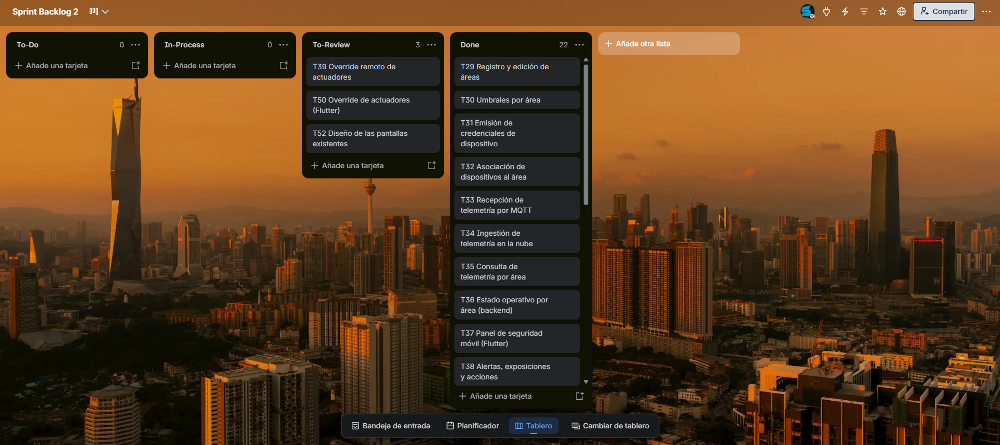

Las user stories asignadas suman 63 story points:

<table>
  <thead>
    <tr>
      <th align="left">Sprint #</th>
      <th align="left" colspan="7">Sprint 2</th>
    </tr>
    <tr>
      <th align="left" colspan="2">User Story</th>
      <th align="left" colspan="6">Work-Item / Task</th>
    </tr>
    <tr>
      <th align="left">Story Id</th>
      <th align="left">Story Title</th>
      <th align="left">Task Id</th>
      <th align="left">Task Title</th>
      <th align="left">Task Description</th>
      <th align="left">Estimation (Hours)</th>
      <th align="left">Assigned To</th>
      <th align="left">Status (To-do / In-Process / To-Review / Done)</th>
    </tr>
  </thead>
  <tbody>
    <tr>
      <td align="left">US20</td>
      <td align="left">Register and manage industrial areas</td>
      <td align="left">T29</td>
      <td align="left">Registro y edición de áreas</td>
      <td align="left">Implementar <code>POST /api/v1/areas</code> y <code>PUT /api/v1/areas/{areaId}</code> con nombre y ubicación, y el rechazo de nombres duplicados.</td>
      <td align="left">5</td>
      <td align="left">Iglesias Pérez, Sergio Sebastián</td>
      <td align="left">Done</td>
    </tr>
    <tr>
      <td align="left">US21</td>
      <td align="left">Configure environmental thresholds by area</td>
      <td align="left">T30</td>
      <td align="left">Umbrales por área</td>
      <td align="left">Implementar <code>PUT /api/v1/areas/{areaId}/thresholds</code> con el límite de CO₂ en ppm y el de ruido en dB.</td>
      <td align="left">4</td>
      <td align="left">Iglesias Pérez, Sergio Sebastián</td>
      <td align="left">Done</td>
    </tr>
    <tr>
      <td align="left" rowspan="2">US22</td>
      <td align="left" rowspan="2">Register IoT devices by area</td>
      <td align="left">T31</td>
      <td align="left">Emisión de credenciales de dispositivo</td>
      <td align="left">Implementar <code>POST /api/v1/devices</code>, el listado y la revocación de credenciales de sensores y actuadores.</td>
      <td align="left">6</td>
      <td align="left">Iglesias Pérez, Sergio Sebastián</td>
      <td align="left">Done</td>
    </tr>
    <tr>
      <td align="left">T32</td>
      <td align="left">Asociación de dispositivos al área</td>
      <td align="left">Implementar <code>POST /api/v1/areas/{areaId}/devices</code> y <code>GET /api/v1/areas/{areaId}/setup</code>.</td>
      <td align="left">4</td>
      <td align="left">Iglesias Pérez, Sergio Sebastián</td>
      <td align="left">Done</td>
    </tr>
    <tr>
      <td align="left" rowspan="3">TS01 / TS09</td>
      <td align="left" rowspan="3">API endpoints for telemetry ingestion and query by area</td>
      <td align="left">T33</td>
      <td align="left">Recepción de telemetría por MQTT</td>
      <td align="left">Implementar el worker que se suscribe al tópico <code>safeplant/v1/+/telemetry</code> del broker Mosquitto en la planta y entrega cada lectura al servicio de admisión.</td>
      <td align="left">6</td>
      <td align="left">Iglesias Pérez, Sergio Sebastián</td>
      <td align="left">Done</td>
    </tr>
    <tr>
      <td align="left">T34</td>
      <td align="left">Ingestión de telemetría en la nube</td>
      <td align="left">Implementar <code>POST /internal/v1/telemetry</code>, protegido con la cabecera <code>X-Plant-Key</code>, que valida la credencial del dispositivo y el formato de la lectura.</td>
      <td align="left">5</td>
      <td align="left">Iglesias Pérez, Sergio Sebastián</td>
      <td align="left">Done</td>
    </tr>
    <tr>
      <td align="left">T35</td>
      <td align="left">Consulta de telemetría por área</td>
      <td align="left">Implementar <code>GET /api/v1/areas/{areaId}/telemetry/latest</code>, <code>GET /api/v1/metrics/dashboard</code> y <code>GET /api/v1/areas/{areaId}/history</code>.</td>
      <td align="left">5</td>
      <td align="left">Iglesias Pérez, Sergio Sebastián</td>
      <td align="left">Done</td>
    </tr>
    <tr>
      <td align="left" rowspan="2">US14</td>
      <td align="left" rowspan="2">Consolidated operational dashboard of plant areas</td>
      <td align="left">T36</td>
      <td align="left">Estado operativo por área (backend)</td>
      <td align="left">Implementar <code>GET /api/v1/areas/operational-status</code> y <code>GET /api/v1/areas/{areaId}/operational-status</code>.</td>
      <td align="left">5</td>
      <td align="left">Iglesias Pérez, Sergio Sebastián</td>
      <td align="left">Done</td>
    </tr>
    <tr>
      <td align="left">T37</td>
      <td align="left">Panel de seguridad móvil (Flutter)</td>
      <td align="left">Implementar el panel con el estado operativo de las áreas y el detalle por área con su última telemetría, consumiendo <code>/api/v1/areas/operational-status</code> y <code>/api/v1/areas/{areaId}/telemetry/latest</code>.</td>
      <td align="left">8</td>
      <td align="left">Solano Armas, Angelo Héctor</td>
      <td align="left">Done</td>
    </tr>
    <tr>
      <td align="left" rowspan="2">US18 / TS10</td>
      <td align="left" rowspan="2">View active alerts / API endpoint for remote actuator override</td>
      <td align="left">T38</td>
      <td align="left">Alertas, exposiciones y acciones</td>
      <td align="left">Implementar <code>GET /api/v1/alerts/active</code>, <code>GET /api/v1/areas/{areaId}/exposures</code> y <code>GET /api/v1/areas/{areaId}/actuator-actions</code>.</td>
      <td align="left">6</td>
      <td align="left">Iglesias Pérez, Sergio Sebastián</td>
      <td align="left">Done</td>
    </tr>
    <tr>
      <td align="left">T39</td>
      <td align="left">Override remoto de actuadores</td>
      <td align="left">Implementar <code>POST /api/v1/areas/{areaId}/actuators/override</code>, que valida el par actuador-estado, reenvía la orden al host de la planta mediante <code>/internal/v1/overrides</code> y exige rol Supervisor desde el canal móvil. Defecto conocido: el endpoint termina devolviendo <code>503</code> aun cuando la planta acepta la orden.</td>
      <td align="left">5</td>
      <td align="left">Iglesias Pérez, Sergio Sebastián</td>
      <td align="left">To-Review</td>
    </tr>
    <tr>
      <td align="left" rowspan="3">US27 / US28</td>
      <td align="left" rowspan="3">Detect CO₂ excess / Detect excessive noise</td>
      <td align="left">T40</td>
      <td align="left">Evaluación de exposición y política de actuadores</td>
      <td align="left">Implementar en el contexto Safety &amp; Actuation las políticas de exposición y de actuadores (presencia con exceso de CO₂ o ruido) y su sincronización con la planta.</td>
      <td align="left">8</td>
      <td align="left">Iglesias Pérez, Sergio Sebastián</td>
      <td align="left">Done</td>
    </tr>
    <tr>
      <td align="left">T41</td>
      <td align="left">Persistencia local y contingencia en planta</td>
      <td align="left">Persistir en SQLite local las lecturas y los eventos de la planta, y publicar las órdenes a los actuadores en <code>safeplant/v1/actuators/{type}</code>.</td>
      <td align="left">8</td>
      <td align="left">Iglesias Pérez, Sergio Sebastián</td>
      <td align="left">Done</td>
    </tr>
    <tr>
      <td align="left">T42</td>
      <td align="left">Contrato MQTT del nodo ESP32</td>
      <td align="left">Definir el mensaje que el nodo publica en <code>safeplant/v1/{deviceId}/telemetry</code> (<code>secret</code>, <code>measure</code>, <code>ppm</code>, <code>db</code>, <code>state</code>, <code>recordedAt</code>) y los comandos que recibe en <code>safeplant/v1/actuators/{type}</code>. El circuito se probó en Wokwi (sección 5.6); en los repositorios visibles de la organización no hay código de firmware.</td>
      <td align="left">4</td>
      <td align="left">>Baldeon Vivar, Santiago Armando</td>
      <td align="left">Done</td>
    </tr>
    <tr>
      <td align="left" rowspan="2">US07 / US10 / US13</td>
      <td align="left" rowspan="2">Safety Supervisor sign-in, sign-out and credential recovery on the mobile app</td>
      <td align="left">T43</td>
      <td align="left">Sesión en la app móvil (Flutter)</td>
      <td align="left">Implementar inicio de sesión con <code>channel</code> igual a <code>Mobile</code>, restauración y cierre de sesión, recuperación y restablecimiento de credenciales. El token y el rol se guardan en <code>flutter_secure_storage</code> y un rol distinto de supervisor no entra a la aplicación.</td>
      <td align="left">10</td>
      <td align="left">Solano Armas, Angelo Héctor</td>
      <td align="left">Done</td>
    </tr>
    <tr>
      <td align="left">T47</td>
      <td align="left">Unión de la app móvil con el backend</td>
      <td align="left">Alinear los contratos de la app con <code>Cloud.Api</code> (sobre <code>items</code> en alertas, exposiciones y acciones; umbrales enteros; secreto del dispositivo mostrado una sola vez) y configurar la URL de la API con <code>--dart-define=API_BASE_URL</code>.</td>
      <td align="left">8</td>
      <td align="left">Solano Armas, Angelo Héctor</td>
      <td align="left">Done</td>
    </tr>
    <tr>
      <td align="left" rowspan="2">US18 / US26 / US33</td>
      <td align="left" rowspan="2">View active alerts, short exposure history and short log of automatic actions</td>
      <td align="left">T48</td>
      <td align="left">Alertas activas (Flutter)</td>
      <td align="left">Implementar la pantalla de alertas activas con actualización periódica (<code>/api/v1/alerts/active</code>).</td>
      <td align="left">5</td>
      <td align="left">Solano Armas, Angelo Héctor</td>
      <td align="left">Done</td>
    </tr>
    <tr>
      <td align="left">T49</td>
      <td align="left">Historial de exposición y acciones de actuadores (Flutter)</td>
      <td align="left">Implementar las pantallas de historial corto de exposiciones y de acciones ejecutadas por los actuadores.</td>
      <td align="left">6</td>
      <td align="left">Solano Armas, Angelo Héctor</td>
      <td align="left">Done</td>
    </tr>
    <tr>
      <td align="left">US32</td>
      <td align="left">Remote manual actuator override in emergency</td>
      <td align="left">T50</td>
      <td align="left">Override de actuadores (Flutter)</td>
      <td align="left">Implementar la pantalla de override manual de extractor, sirena y mamparas, que llama a <code>/api/v1/areas/{areaId}/actuators/override</code>.</td>
      <td align="left">6</td>
      <td align="left">Solano Armas, Angelo Héctor</td>
      <td align="left">To-Review</td>
    </tr>
    <tr>
      <td align="left" rowspan="1">US20 / US21 / US22</td>
      <td align="left">Manage areas, thresholds and devices from the mobile app</td>
      <td align="left">T51</td>
      <td align="left">Configuración de planta (Flutter)</td>
      <td align="left">Implementar el alta y la edición de áreas, la configuración de umbrales, el registro, el inventario y la revocación de dispositivos, y la vista de configuración del área.</td>
      <td align="left">12</td>
      <td align="left">Solano Armas, Angelo Héctor</td>
      <td align="left">Done</td>
    </tr>
    <tr>
      <td align="left">—</td>
      <td align="left">Diseño visual de la app móvil</td>
      <td align="left">T52</td>
      <td align="left">Diseño de las pantallas existentes</td>
      <td align="left">Aplicar el tema, la tipografía y el diseño visual a las pantallas de sesión, seguridad y configuración de planta. Está en la rama <code>diseno/ui-movil</code> y falta integrarlo a <code>main</code>.</td>
      <td align="left">8</td>
      <td align="left">Gordillo Ramos, Santiago Alonso</td>
      <td align="left">To-Review</td>
    </tr>
    <tr>
      <td align="left">—</td>
      <td align="left">Pruebas de la app móvil</td>
      <td align="left">T53</td>
      <td align="left">Suite de pruebas Flutter</td>
      <td align="left">Escribir pruebas de casos de uso, DTO, mappers, controladores y páginas de sesión, seguridad y configuración de planta, y actualizarlas al contrato de <code>Cloud.Api</code>.</td>
      <td align="left">10</td>
      <td align="left">Solano Armas, Angelo Héctor</td>
      <td align="left">Done</td>
    </tr>
    <tr>
      <td align="left">—</td>
      <td align="left">Integración de la aplicación web con la API</td>
      <td align="left">T44</td>
      <td align="left">Integración de la aplicación web</td>
      <td align="left">Reemplazar los datos de muestra por la API en el inicio de sesión, el dashboard y el historial, con interceptor de autenticación, guard de sesión y proxy de desarrollo.</td>
      <td align="left">8</td>
      <td align="left">Iglesias Pérez, Sergio Sebastián</td>
      <td align="left">Done</td>
    </tr>
    <tr>
      <td align="left">—</td>
      <td align="left">Entorno local de pruebas</td>
      <td align="left">T45</td>
      <td align="left">Docker Compose</td>
      <td align="left">Definir <code>compose.yaml</code> con TimescaleDB, Eclipse Mosquitto, <code>Cloud.Api</code> y <code>Plant.Host</code> para probar el flujo completo en local.</td>
      <td align="left">3</td>
      <td align="left">Iglesias Pérez, Sergio Sebastián</td>
      <td align="left">Done</td>
    </tr>
    <tr>
      <td align="left">—</td>
      <td align="left">Documentación del informe</td>
      <td align="left">T46</td>
      <td align="left">Sprint 2 en el informe</td>
      <td align="left">Documentar el Sprint 2: planning, backlog, evidencias de desarrollo, pruebas, ejecución, servicios, despliegue y colaboración.</td>
      <td align="left">5</td>
      <td align="left">Gordillo Ramos, Santiago Alonso</td>
      <td align="left">Done</td>
    </tr>
  </tbody>
</table>

<a id="s-6-2-2-4"></a>
#### 6.2.2.4. Development Evidence for Sprint Review

Durante el Sprint 2 se implementaron en "safeplant-web-backend" los contextos Plant Monitoring, Safety & Actuation y Device & Edge Management, con el host de planta además de la API en la nube, se integró "safeplant-web-client" con la API y se construyó la aplicación móvil, con arquitectura por capas. En el backend, cada contexto se desarrolló en su rama "feature/*" y se integró en "develop".

**Repositorios de producto** 

| Repository | Branch | Commit Id | Commit Message | Commit Message Body | Committed on (Date) |
| :--- | :--- | :--- | :--- | :--- | :--- |
| Macallys/safeplant-web-backend | develop | [616b0e0](https://github.com/Macallys/safeplant-web-backend/commit/616b0e0f9f4b7cdfa1ea0065389e75388e0ed751) | feat: area functionality | - | 2026-10-23 |
| Macallys/safeplant-web-backend | develop | [698f09a](https://github.com/Macallys/safeplant-web-backend/commit/698f09adb679f72b42570e7d76fc101d1eecf3f0) | feat: threshold definition | - | 2026-10-23 |
| Macallys/safeplant-web-backend | develop | [12e9f14](https://github.com/Macallys/safeplant-web-backend/commit/12e9f144cd8e2cab1b83044b3ccc26a23f760562) | feat: plant monitoring - dashboard | - | 2026-11-11 |
| Macallys/safeplant-web-backend | develop | [e8ef621](https://github.com/Macallys/safeplant-web-backend/commit/e8ef62198e4046b78a9513b02871f2a82996588d) | feat: safety infrastructure and domain | - | 2026-11-11 |
| Macallys/safeplant-web-backend | develop | [0250c31](https://github.com/Macallys/safeplant-web-backend/commit/0250c3148cd9c17147fa3e1169db1a8645e433cb) | feat: operative status | - | 2026-11-11 |
| Macallys/safeplant-web-backend | develop | [5856652](https://github.com/Macallys/safeplant-web-backend/commit/58566526893fc238c64c980d7f4ad74c9c89cd55) | feat: logs, alerts and override | - | 2026-11-11 |
| Macallys/safeplant-web-backend | develop | [2d2b742](https://github.com/Macallys/safeplant-web-backend/commit/2d2b7425259edc7638ce70673acc36e013aabeba) | feat: device and edge contxt | - | 2026-11-11 |
| Macallys/safeplant-web-backend | develop | [574ea14](https://github.com/Macallys/safeplant-web-backend/commit/574ea14935f6d32ee0c00ecf2296090583ebdb4f) | chore: docker file for local testing | - | 2026-11-11 |
| Macallys/safeplant-web-backend | develop | [b17cf98](https://github.com/Macallys/safeplant-web-backend/commit/b17cf98e1f51c0006092f2b47e907b438a0a1a04) | feat: local persistence on plant and mqtt implementation | - | 2026-11-12 |
| Macallys/safeplant-web-backend | develop | [58b3bf4](https://github.com/Macallys/safeplant-web-backend/commit/58b3bf410b5f1240fee3a82b445614e74dbd26c1) | fix: actuators policy for presence | - | 2026-11-12 |
| Macallys/safeplant-web-client | main | [668dacd](https://github.com/Macallys/safeplant-web-client/commit/668dacd) | chore: api integration | - | 2026-11-12 |
| Macallys/App-Movil | main | [8ba1ba6](https://github.com/Macallys/App-Movil/commit/8ba1ba60deb4adaeaec1a0f6c112c391793d5039) | app safe primera version | - | 2026-10-29 |
| Macallys/App-Movil | diseno/ui-movil | [44f92e7](https://github.com/Macallys/App-Movil/commit/44f92e7a8ab93aa97cb65949e92e4a4be96c0ba7) | Diseño visual de las pantallas existentes | - | 2026-11-05 |
| Macallys/App-Movil | main | [8d352a2](https://github.com/Macallys/App-Movil/commit/8d352a223d89c6838f5dd72cda4c112ce651d3eb) | Align area setup with Cloud.Api GET /areas/{id}/setup | - | 2026-11-12 |
| Macallys/App-Movil | main | [351ecbc](https://github.com/Macallys/App-Movil/commit/351ecbca42af9a1e0941033e4a0aa7a43187606d) | Show device secret once and keep lastSeenAt on inventory | - | 2026-11-12 |
| Macallys/App-Movil | main | [845ebe0](https://github.com/Macallys/App-Movil/commit/845ebe077c714e92b64b6a96d3d474cddeed3d55) | Add PUT area edit flow from setup screen | - | 2026-11-12 |
| Macallys/App-Movil | main | [aec1652](https://github.com/Macallys/App-Movil/commit/aec165230ac5177de730717158a275ab67d28d78) | Update plant setup UI for integer thresholds and device secret | - | 2026-11-12 |
| Macallys/App-Movil | main | [0204f31](https://github.com/Macallys/App-Movil/commit/0204f31f06421693a08dba96d78cced071dec35d) | Update plant setup UI for integer thresholds and device secret | - | 2026-11-12 |
| Macallys/App-Movil | main | [83a3b4b](https://github.com/Macallys/App-Movil/commit/83a3b4b12c5b1be3e811da1475c61c43a802dd13) | Align alerts exposures and actions with items envelope contract | - | 2026-11-12 |
| Macallys/App-Movil | main | [afd1f26](https://github.com/Macallys/App-Movil/commit/afd1f264869fbb5f8d2776d0953d0d798b859098) | Update plant setup tests for signed Cloud.Api contract | - | 2026-11-12 |
| Macallys/App-Movil | main | [c81a22c](https://github.com/Macallys/App-Movil/commit/c81a22c4d44835929abe3b2b3fe5729078b99aa6) | Update safety tests for telemetry alerts and override contract | - | 2026-11-12 |
| Macallys/App-Movil | main | [2b40542](https://github.com/Macallys/App-Movil/commit/2b405424a6f337d978beb27fad4c364268fefde5) | feature: Union con el backend version 1 | - | 2026-11-12 |

**Repositorio del informe (Reporte)**

| Repository | Branch | Commit Id | Commit Message | Commit Message Body | Committed on (Date) |
| :--- | :--- | :--- | :--- | :--- | :--- |
| Macallys/Report | develop | [65f4dfe](https://github.com/Macallys/Report/commit/65f4dfe5e6e3d542af8fe03b7376f95f289e069a) | docs: add sprint 2 skeleton | - | 2026-10-23 |
| Macallys/Report | develop | [e090609](https://github.com/Macallys/Report/commit/e0906091213c2d0a2cc7835f354e9f2eaec62821) | Documentar avance del Sprint 2 de SafePlant | - | 2026-11-13 |
| Macallys/Report | develop | [49a892a](https://github.com/Macallys/Report/commit/49a892ab3f9978f169bb1f20552e1f3ff03bd258) | Update Sprint 2 documentation in informe.md | - | 2026-11-13 |
| Macallys/Report | develop | [16104c5](https://github.com/Macallys/Report/commit/16104c5349c7a3db13f410e715231a41859cff84) | Revise documentation  Sprint 2 | - | 2026-11-13 |
| Macallys/Report | develop | [9fc76fa](https://github.com/Macallys/Report/commit/9fc76fa39d990aa094ed0ef74be030c011d4a353) | Update informe.md | - | 2026-11-13 |
| Macallys/Report | develop | [50b7f41](https://github.com/Macallys/Report/commit/50b7f41d15bb4600a42e6af9f7945f231385e2b7) | Update commit history and documentation in informe.md | - | 2026-11-13 |
| Macallys/Report | develop | [6beac4a](https://github.com/Macallys/Report/commit/6beac4a40f18da9e755bb2d160ac1655a1cdeff1) | Document mobile testing suite and execution evidence | - | 2026-11-13 |
| Macallys/Report | develop | [f0c71a5](https://github.com/Macallys/Report/commit/f0c71a56f98f72193a765672fd0f2f8df7a73ce8) | Update Sprint 2 velocity and task assignments | - | 2026-11-14 |

**Trazabilidad por User Story**

| User Story | Tarea | Commits | Estado |
| :--- | :--- | :--- | :---: |
| US20 Register and manage industrial areas | T29 | `616b0e0` | Done |
| US21 Configure environmental thresholds by area | T30 | `698f09a` | Done |
| US22 Register IoT devices by area | T31, T32 | `2d2b742` | Done |
| TS01 / TS09 Telemetry ingestion and query by area | T33, T34, T35 | `2d2b742`, `b17cf98`, `12e9f14` | Done |
| US14 Consolidated operational dashboard of plant areas | T36, T37 | `0250c31` (backend), `8ba1ba6`, `2b40542` (móvil) | Done |
| US18 / TS10 View active alerts / Remote actuator override | T38, T39 | `5856652` | Done / To-Review |
| US27 / US28 Detect CO₂ excess / Detect excessive noise | T40, T41, T42 | `e8ef621`, `b17cf98`, `58b3bf4` | Done |
| US07 / US10 / US13 Sesión en la app móvil | T43, T47 | `8ba1ba6`, `2b40542` | Done |
| US18 / US26 / US33 Alertas, exposiciones y acciones (móvil) | T48, T49 | `8ba1ba6`, `83a3b4b`, `2b40542` | Done |
| US32 Remote manual actuator override (móvil) | T50 | `8ba1ba6`, `2b40542` | To-Review |
| US20 / US21 / US22 Configuración de planta (móvil) | T51 | `8ba1ba6`, `8d352a2`, `845ebe0`, `351ecbc`, `aec1652`, `0204f31` | Done |
| — Diseño visual de la app móvil | T52 | `44f92e7` (rama `diseno/ui-movil`) | To-Review |
| — Pruebas de la app móvil | T53 | `afd1f26`, `c81a22c` | Done |
| — Integración de la aplicación web con la API | T44 | `668dacd` | Done |
| — Entorno local de pruebas | T45 | `574ea14` | Done |

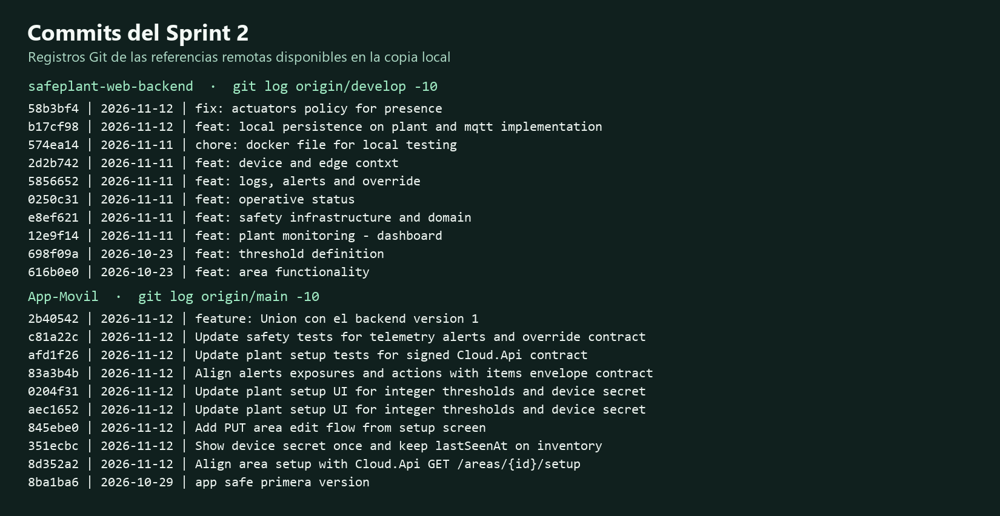

<a id="s-6-2-2-5"></a>
#### 6.2.2.5. Testing Suite Evidence for Sprint Review

**Mobile Testing Suite Evidence**

Para la aplicación móvil se implementó una suite de pruebas automatizadas que valida las funcionalidades de sesión, seguridad y configuración de planta incluidas en el Sprint Backlog 2. Las pruebas están en la carpeta test/ del repositorio App-Movil, en la rama `main`, y se ejecutan con el comando:

```bash
flutter test
```

**Repository:** https://github.com/Macallys/App-Movil.git

La suite incluye 66 archivos de prueba con 296 casos: 230 pruebas unitarias y 66 pruebas de widget. Las pruebas unitarias cubren los casos de uso, los DTO, los mappers, los repositorios y los controladores; las de widget validan las páginas; y las pruebas de contrat verifican que la app interpreta las respuestas de Cloud.Api. Para no depender del backend desplegado, las pruebas usan dobles del datasource remoto. No hay archivos `.feature` en Gherkin.

| Módulo | Archivos de prueba | Casos de prueba | Cobertura |
| :--- | ---: | ---: | :--- |
| `session` | 12 | 36 | Inicio, restauración y cierre de sesión, recuperación y restablecimiento de credenciales, interceptor de autenticación |
| `safety` | 26 | 139 | Estado operativo, última telemetría, alertas activas, historial de exposiciones, acciones de actuadores y override |
| `plant_setup` | 21 | 102 | Áreas, umbrales, registro, inventario y revocación de dispositivos |
| `app`, `core` y raíz | 7 | 19 | Router, shell de la aplicación, tema, configuración del cliente HTTP y manifiesto de Android |
| **Total** | **66** | **296** | |

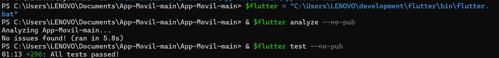

**Tabla de commits relacionados al mobile testing**

| Repository | Branch | Commit Id | Commit Message | Archivos de prueba modificados | Committed on (Date) |
| :--- | :--- | :--- | :--- | ---: | :--- |
| Macallys/App-Movil | main | [8ba1ba6](https://github.com/Macallys/App-Movil/commit/8ba1ba60deb4adaeaec1a0f6c112c391793d5039) | app safe primera version | 31 | 2026-10-29 |
| Macallys/App-Movil | main | [afd1f26](https://github.com/Macallys/App-Movil/commit/afd1f264869fbb5f8d2776d0953d0d798b859098) | Update plant setup tests for signed Cloud.Api contract | 3 | 2026-11-12 |
| Macallys/App-Movil | main | [c81a22c](https://github.com/Macallys/App-Movil/commit/c81a22c4d44835929abe3b2b3fe5729078b99aa6) | Update safety tests for telemetry alerts and override contract | 7 | 2026-11-12 |

<a id="s-6-2-2-6"></a>
#### 6.2.2.6. Execution Evidence for Sprint Review

Al cierre del Sprint 2 la aplicación móvil se compila y ejecuta, y el flujo completo del backend se ejecuta en local con Docker Compose, que levanta TimescaleDB, el broker Eclipse Mosquitto, Cloud.Api y Plant.Host. Una lectura publicada en el tópico MQTT del dispositivo llega al host de la planta, se guarda en la base local y se envía a la nube, donde la consultan el dashboard y el historial de la aplicación web integrada con la API.

**Backend: entorno local con Docker Compose**

El comando docker compose up levanta cuatro servicios: TimescaleDB (puerto 5432), Eclipse Mosquitto (puerto 1883), Cloud.Api (puerto 8080) y Plant.Host. Desde `http://localhost:8080/swagger/index.html` se prueban los endpoints documentados en la sección 6.2.2.7.

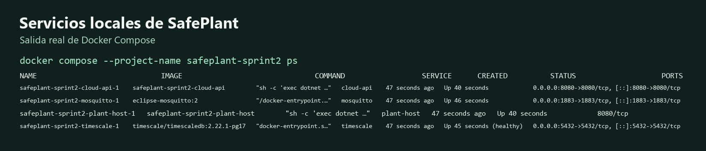

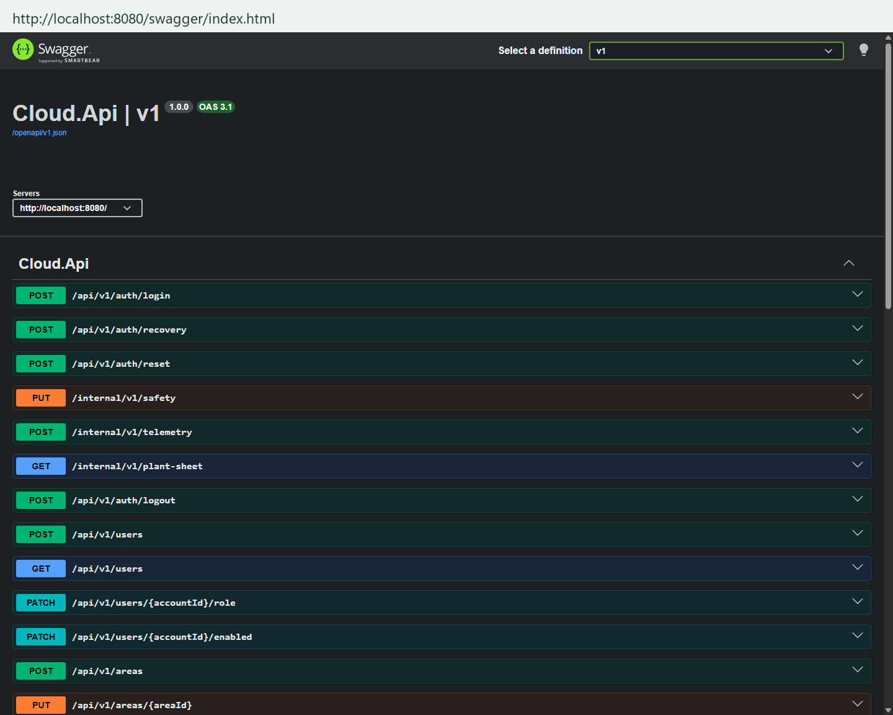

**Web: aplicación del Encargado de Planta integrada con la API**

La aplicación web deja de usar datos de muestra en el inicio de sesión, el dashboard y el historial, y consume la API mediante un interceptor de autenticación y un guard de sesión.


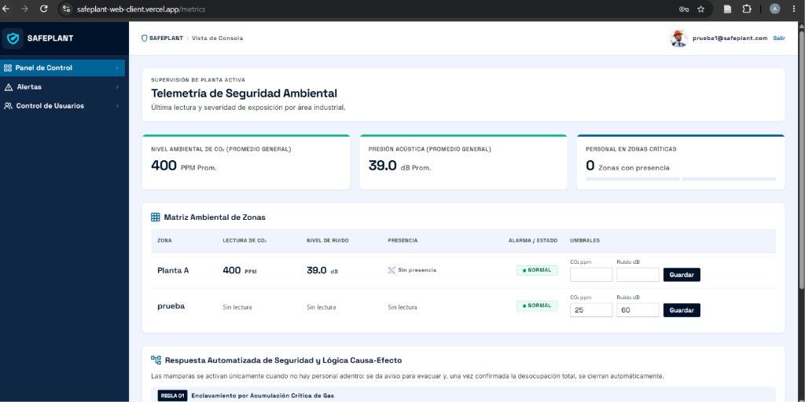


**Mobile: aplicación del Supervisor de Seguridad**

La aplicación móvil arranca en una pantalla de inicio que restaura la sesión guardada. Desde el inicio de sesión el supervisor accede a dos módulos: Seguridad, con el panel de áreas, y Configuración de planta.


<a id="s-6-2-2-7"></a>
#### 6.2.2.7. Services Documentation Evidence for Sprint Review

Durante el Sprint 2 se documentaron los Web Services de SafePlant mediante OpenAPI y Swagger UI. Esta documentación permitió visualizar los endpoints de los bounded contexts Plant Monitoring, Safety and Actuation y Device and Edge Management, incluyendo sus métodos HTTP, rutas, parámetros, cuerpos de solicitud, códigos de respuesta y ejemplos de ejecución. Los servicios fueron validados en el entorno desplegado: el backend Cloud.Api se encuentra alojado en Azure App Service (wa-safeplant-cloudbackend-prod) y utiliza TimescaleDB sobre PostgreSQL para el registro en la nube, además del entorno local con Docker Compose (TimescaleDB, Eclipse Mosquitto, Cloud.Api y Plant.Host).

La documentación generada permite comprobar que los endpoints del Sprint 2 se encuentran disponibles y organizados por módulos funcionales. Entre ellos se incluyen los servicios de áreas y umbrales de CO₂ y ruido, telemetría y dashboard, estado operativo, alertas, exposiciones, acciones de actuadores, override remoto y credenciales de dispositivos. Desde Swagger UI se realizaron pruebas sobre las rutas expuestas, verificando la disponibilidad del API, el uso de autenticación mediante JWT en /api/v1, la clave de planta X-Plant-Key en /internal/v1 y la persistencia de información en la base desplegada. Los errores conservan el formato uniforme del Sprint 1.

URL de Swagger UI desplegado: https://wa-safeplant-cloudbackend-prod.azurewebsites.net/swagger/index.html

URL de documentación OpenAPI: https://wa-safeplant-cloudbackend-prod.azurewebsites.net/openapi/v1.json

Repositorio de Web Services: https://github.com/Macallys/safeplant-web-backend

Roles: S = Supervisor desde el canal móvil; M = Plant Manager desde el canal web.

| Endpoint | Verbo HTTP | Sintaxis de llamada | Parámetros | Response | Commit |
| :--- | :---: | :--- | :--- | :--- | :---: |
| Create area (S) | POST | `/api/v1/areas` | Header `Authorization`; Body JSON: `name`, `location` | `201 Created` con `id`, `name`, `location`. `422` `invalid_area`; `409` `area_name_duplicate`. | `616b0e0` |
| Update area (S) | PUT | `/api/v1/areas/{areaId}` | Header `Authorization`; path `areaId`; Body JSON: `name`, `location` | `200 OK` con `id`, `name`, `location`. `404` `area_not_found`; `422` `invalid_area`; `409` `area_name_duplicate`. | `616b0e0` |
| Set thresholds (S, M) | PUT | `/api/v1/areas/{areaId}/thresholds` | Header `Authorization`; path `areaId`; Body JSON: `co2LimitPpm` (entero, 1 a 50 000), `noiseLimitDb` (entero, 1 a 140) | `200 OK` con `areaId`, `co2LimitPpm`, `noiseLimitDb`. `404` `area_not_found`; `422` `co2_limit_out_of_range` o `noise_limit_out_of_range`. | `698f09a` |
| Associate device to area (S) | POST | `/api/v1/areas/{areaId}/devices` | Header `Authorization`; path `areaId`; Body JSON: `deviceId`, `kind` | `201 Created` con `id`, `areaId`, `deviceId`, `kind`. `404` `area_not_found`; `422` `invalid_device`. | `2d2b742` |
| Area setup | GET | `/api/v1/areas/{areaId}/setup` | Header `Authorization`; path `areaId` | `200 OK` con `id`, `name`, `location`, `co2LimitPpm`, `noiseLimitDb` y `devices`. `404` `area_not_found`. | `2d2b742` |
| Latest telemetry by area (S) | GET | `/api/v1/areas/{areaId}/telemetry/latest` | Header `Authorization`; path `areaId` | `200 OK` con `areaId` y las últimas lecturas `carbonDioxide`, `noise` y `presence`. `404` `area_not_found`. | `12e9f14` |
| Metrics dashboard (M) | GET | `/api/v1/metrics/dashboard` | Header `Authorization` | `200 OK` con `items`: por área, `areaId`, `name`, `co2Ppm`, `noiseDb`, `presenceState`, `severity`, `alertActive`, `highlighted`, `co2LimitPpm`, `noiseLimitDb`. | `12e9f14` |
| Area history (M) | GET | `/api/v1/areas/{areaId}/history` | Header `Authorization`; path `areaId`; query `from`, `to` (fechas ISO 8601) | `200 OK` con `carbonDioxideReadings`, `noiseReadings`, `presenceChanges`, `alerts` y `actions`. `422` `invalid_period` si `from` no es anterior a `to` o el rango supera 31 días; `404` `area_not_found`. | `12e9f14` |
| Operational status (S, M) | GET | `/api/v1/areas/operational-status` | Header `Authorization` | `200 OK` con `items`: `areaId`, `name`, `co2Ppm`, `noiseDb`, `presenceState`, `severity`, `alertActive`, `highlighted` y `actuators`. | `0250c31` |
| Operational status by area (S, M) | GET | `/api/v1/areas/{areaId}/operational-status` | Header `Authorization`; path `areaId` | `200 OK` con el estado del área. `404` `area_not_found`. | `0250c31` |
| Active alerts (S, M) | GET | `/api/v1/alerts/active` | Header `Authorization` | `200 OK` con `items`: `id`, `areaId`, `raisedAt`, `withdrawnAt`. | `5856652` |
| Area exposures (S, M) | GET | `/api/v1/areas/{areaId}/exposures` | Header `Authorization`; path `areaId` | `200 OK` con `items` de alerta. `404` `area_not_found`. | `5856652` |
| Actuator actions (S, M) | GET | `/api/v1/areas/{areaId}/actuator-actions` | Header `Authorization`; path `areaId` | `200 OK` con `items`: `id`, `areaId`, `type`, `succeeded`, `recordedAt`. `404` `area_not_found`. | `5856652` |
| Actuator override (S) | POST | `/api/v1/areas/{areaId}/actuators/override` | Header `Authorization`; path `areaId`; Body JSON: `actuatorType` y `runState` (`Extractor` o `Siren` con `On` u `Off`; `Barrier` con `Deployed` o `Retracted`) | `400` `invalid_action`; `404` `area_not_found`; `503` `edge_unreachable` si la planta no acepta la orden. Defecto: el endpoint devuelve `503` también cuando la planta responde `204`. | `5856652`, `b17cf98` |
| Issue device credential (S) | POST | `/api/v1/devices` | Header `Authorization`; Body JSON: `deviceId`, `areaId`, `kind` | `201 Created` con `deviceId`, `issuedAt`, `expiresAt`, `secret` (se entrega una sola vez). `409` `device_already_exists`; `422` `invalid_device`. | `2d2b742` |
| List devices (S) | GET | `/api/v1/devices` | Header `Authorization` | `200 OK` con `items`: `deviceId`, `areaId`, `kind`, `issuedAt`, `expiresAt`, `revokedAt`, `lastSeenAt`. | `2d2b742` |
| Revoke device (S) | POST | `/api/v1/devices/{deviceId}/revoke` | Header `Authorization`; path `deviceId` | `200 OK` con `deviceId` y `revokedAt`. `404` `device_not_found`. | `2d2b742` |
| Ingest telemetry (interno) | POST | `/internal/v1/telemetry` | Header `X-Plant-Key`; Body JSON: `deviceId`, `secret`, `measure` (`carbonDioxide`, `noise` o `presence`), `ppm`, `db`, `state`, `recordedAt` | `204 No Content`. `422` `invalid_reading`; `403` `credential_revoked` o `credential_expired`. | `2d2b742`, `b17cf98` |
| Plant sheet (interno) | GET | `/internal/v1/plant-sheet` | Header `X-Plant-Key` | `200 OK` con áreas, umbrales, dispositivos y credenciales que la planta replica. | `2d2b742` |
| Safety sync (interno) | PUT | `/internal/v1/safety` | Header `X-Plant-Key` | `204 No Content` cuando la planta sincroniza sus registros de seguridad. `422` `invalid_safety`. | `e8ef621`, `b17cf98` |
| Plant override (interno, `Plant.Host`) | POST | `/internal/v1/overrides` | Header `X-Plant-Key`; Body JSON: `areaId`, `actuatorType`, `runState` | `204 No Content` cuando la planta acepta la orden. | `b17cf98` |

Además de HTTP, la planta recibe la telemetría de los nodos por MQTT: el nodo publica en `safeplant/v1/{deviceId}/telemetry` (QoS configurado en el broker Mosquitto) y `Plant.Host` publica las órdenes a los actuadores en `safeplant/v1/actuators/{type}` con QoS 1 y el cuerpo `areaId`, `runState` y `mode` (`Auto` u `Overridden`).

**Ejemplo de interacción (Ingest telemetry, lectura de CO₂):**

```http
POST /internal/v1/telemetry
X-Plant-Key: <clave-de-la-planta>
Content-Type: application/json

{
  "deviceId": "co2-sensor-01",
  "secret": "********",
  "measure": "carbonDioxide",
  "ppm": 1200,
  "recordedAt": "2026-11-12T15:30:00Z"
}
```

```http
HTTP/1.1 204 No Content
```

Documentación OpenAPI de los servicios de SafePlant:

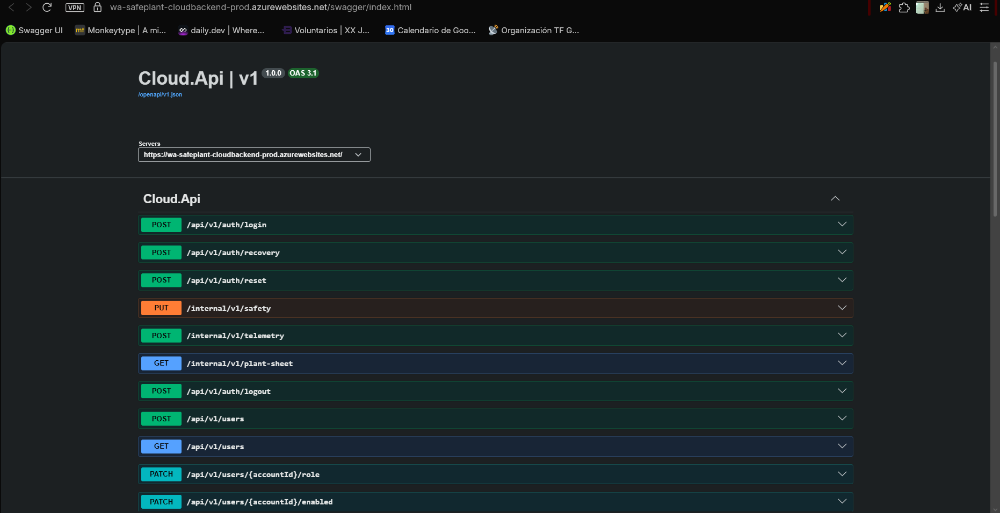

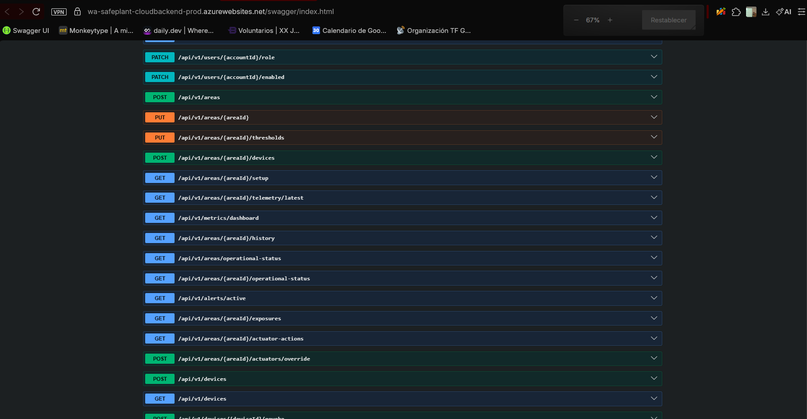


<a id="s-6-2-2-8"></a>
#### 6.2.2.8. Software Deployment Evidence for Sprint Review

El despliegue en producción del backend se hace con un workflow de GitHub Actions que se dispara con cada push a main. La aplicación web App Service wa-safeplant-cloudbackend-prod corre en Azure (East US) sobre el plan asp-safeplant-lab-eus. En el entorno local, Docker Compose levanta los cuatro servicios del flujo completo. La aplicación móvil se construye y publica con el workflow build-apk.yml de App-Movil: en cada push a main se ejecutan las pruebas Flutter, se genera el APK release apuntando a Cloud.Api y se publica el release SafePlant Mobile v0.1.0 con el artefacto app-release.apk.

| Producto | Repositorio | Plataforma | URL / ubicación | Mecanismo |
| :--- | :--- | :--- | :--- | :--- |
| Backend (Cloud API) | `safeplant-web-backend` | Azure App Service (`wa-safeplant-cloudbackend-prod`) | [https://wa-safeplant-cloudbackend-prod.azurewebsites.net](https://wa-safeplant-cloudbackend-prod.azurewebsites.net) | Workflow de GitHub Actions en cada push a `main` |
| Host de planta (Plant.Host) | `safeplant-web-backend` | Docker Compose (local) | `compose.yaml` | `docker compose up` |
| Aplicación web | `safeplant-web-client` | Vercel | [https://safeplant-web-client.vercel.app](https://safeplant-web-client.vercel.app) | Despliegue automático en cada push |
| Landing page | `landing-page` | GitHub Pages | [https://macallys.github.io/landing-page/](https://macallys.github.io/landing-page/) | Publicación desde la rama `main` |
| Aplicación móvil | `App-Movil` | APK Android (`SafePlant Mobile v0.1.0`) | [Release v0.1.0 — `app-release.apk`](https://github.com/Macallys/App-Movil/releases/tag/v0.1.0) | GitHub Actions (`build-apk.yml`) en push a `main` + Release |
| Nodo IoT | Sin repositorio de firmware visible en la organización | Simulador Wokwi (sección 5.6) | [Wokwi — nodo SafePlant](https://wokwi.com/projects/477285427305212929) | Ejecución en el simulador |

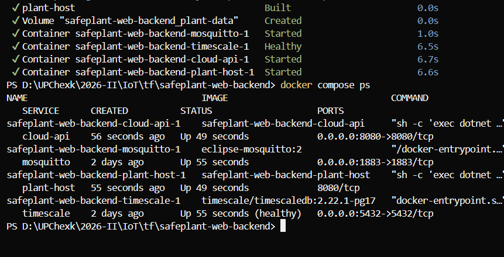

Configuración del workflow de build y release del APK

Para automatizar el despliegue móvil, se configuró el workflow Build and Release APK dentro del repositorio App-Movil de la organización Macallys. Este flujo se ejecuta ante cambios en la rama main o de forma manual mediante workflow_dispatch. La configuración prepara el entorno con Java 17 y Flutter 3.47.5, instala dependencias con flutter pub get, ejecuta la suite de pruebas, genera el APK en modo release con dart-define API_BASE_URL apuntando a Cloud.Api en Azure y publica el artefacto en GitHub Releases.

La imagen evidencia la definición del archivo build-apk.yml, donde se especifican el checkout del código, la instalación de Flutter, la ejecución de flutter test, la construcción del APK mediante flutter build apk --release y la carga del archivo app-release.apk como artefacto safeplant-android-release.

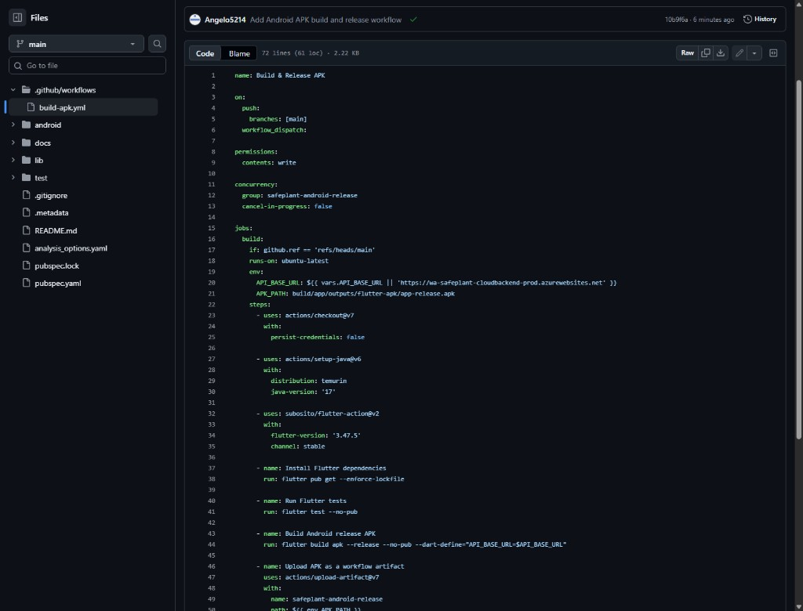

Ejecución del workflow en GitHub Actions

Una vez configurado el flujo, se ejecutó el workflow desde GitHub Actions para validar que el pipeline de construcción y publicación pudiera completarse correctamente desde el repositorio móvil. Esta ejecución permite comprobar que el despliegue no depende de acciones manuales locales y que el APK puede generarse en un entorno controlado.

La imagen muestra el inicio del check asociado al workflow Build and Release APK, confirmando que GitHub detectó la ejecución del proceso de despliegue móvil sobre el commit 10b9f6a de la rama main.

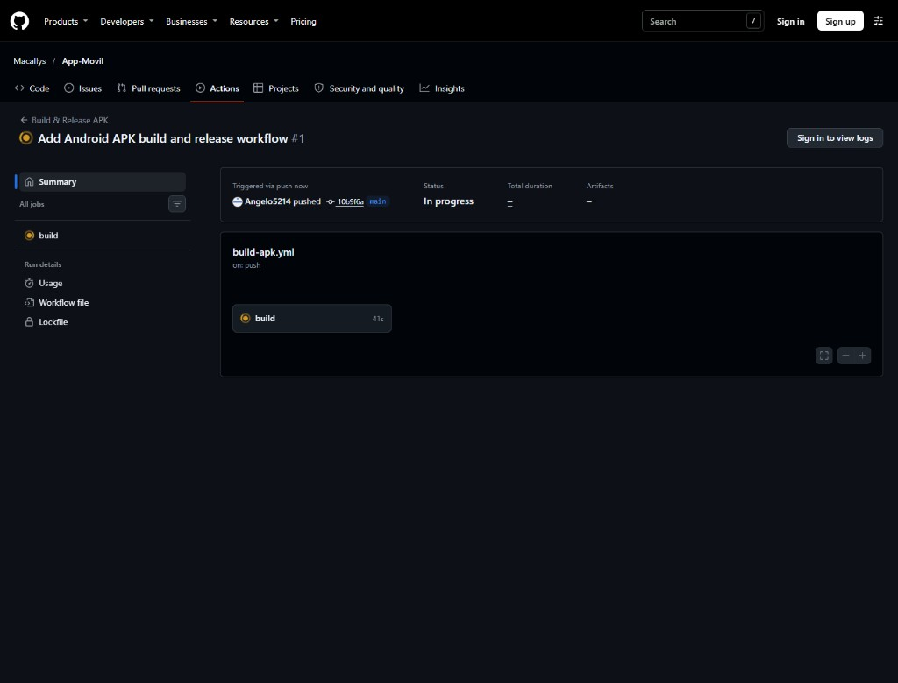

Durante la ejecución se observa la preparación del entorno, la descarga de Flutter, la instalación de dependencias del proyecto y el avance del job de build. Esto evidencia que la aplicación móvil del Supervisor de Seguridad fue construida dentro de GitHub Actions y no únicamente desde un entorno local de desarrollo.

Validación del build del APK

Finalizada la ejecución, GitHub Actions reportó el estado exitoso del job de construcción. Esta validación confirma que el código fuente de la aplicación móvil compila correctamente y que el workflow puede generar el artefacto de despliegue esperado.

La imagen evidencia que el workflow build-apk.yml terminó con estado Success (6 m 17 s), después de ejecutar el job de build. Con ello se valida que el proceso automatizado queda disponible para futuras versiones de SafePlant Mobile y que el artefacto safeplant-android-release (51.1 MB) quedó disponible para descarga.

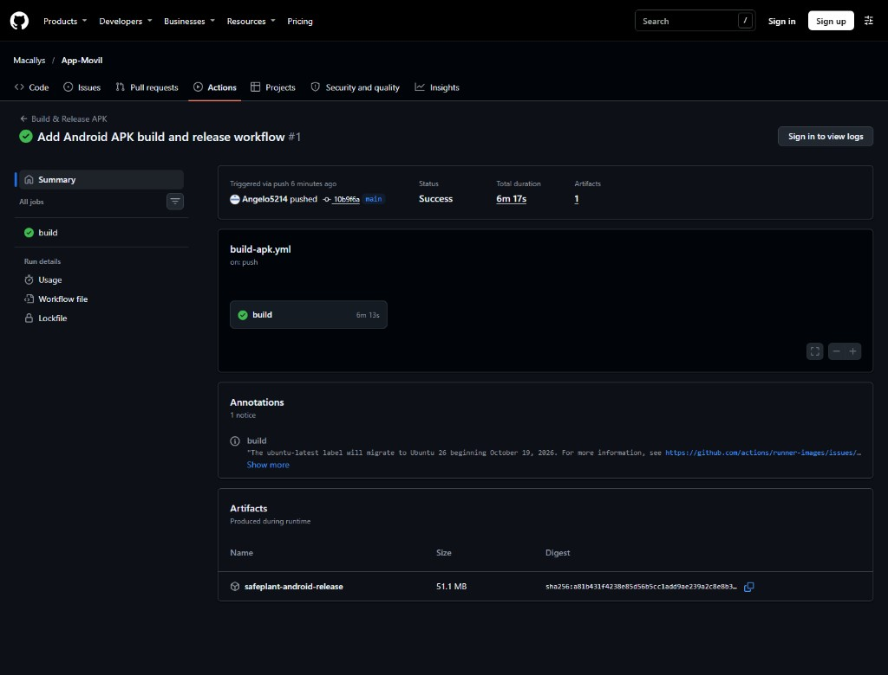

Publicación del APK en GitHub Releases

Como resultado del workflow, se generó una release del proyecto móvil con el APK listo para descarga. Esta publicación permite distribuir la aplicación Android del Supervisor generada durante el Sprint 2 y contar con una versión identificable para revisión, instalación y pruebas académicas.

La evidencia muestra la release SafePlant Mobile v0.1.0 marcada como Latest, junto con el archivo app-release.apk como asset descargable. De esta manera, el Sprint 2 incorpora una evidencia de despliegue móvil equivalente al deployment evidence del Sprint 1, pero orientada a la generación y publicación de la aplicación Android.

Página de releases del APK: https://github.com/Macallys/App-Movil/releases

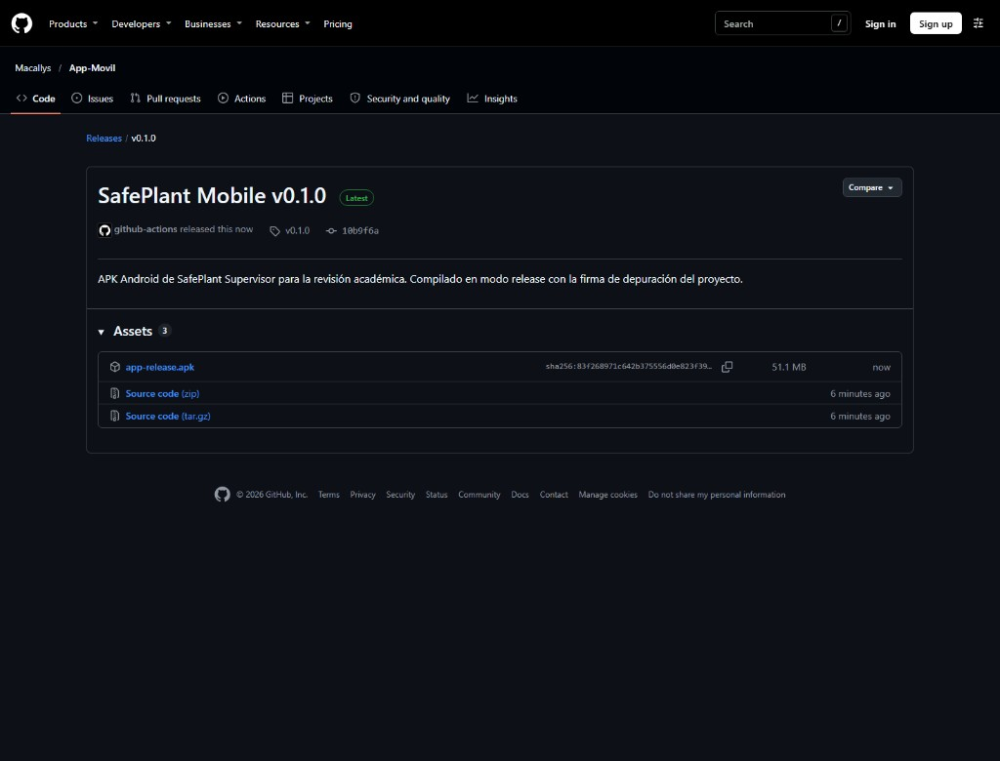

Backend — Azure App Service en ejecución

El backend Cloud.Api permanece desplegado en Azure App Service. El plan asp-safeplant-lab-eus (Linux, East US, B1) sostiene la aplicación web wa-safeplant-cloudbackend-prod, cuyo estado en el portal aparece como En ejecución y cuyo último despliegue figura como Correcto. Las métricas de CPU, memoria y datos de entrada confirman que el servicio está activo y recibe tráfico.

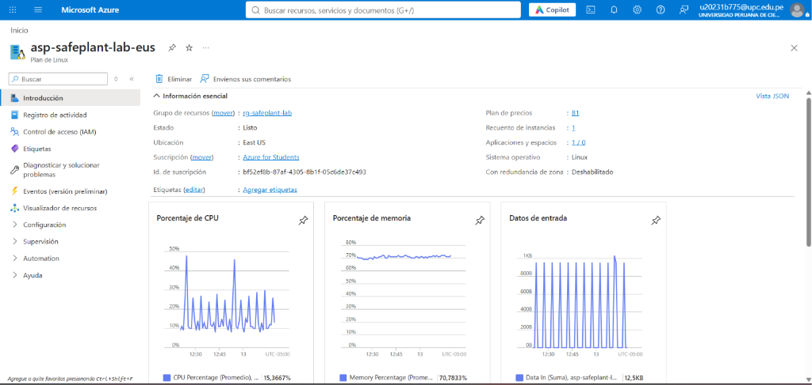

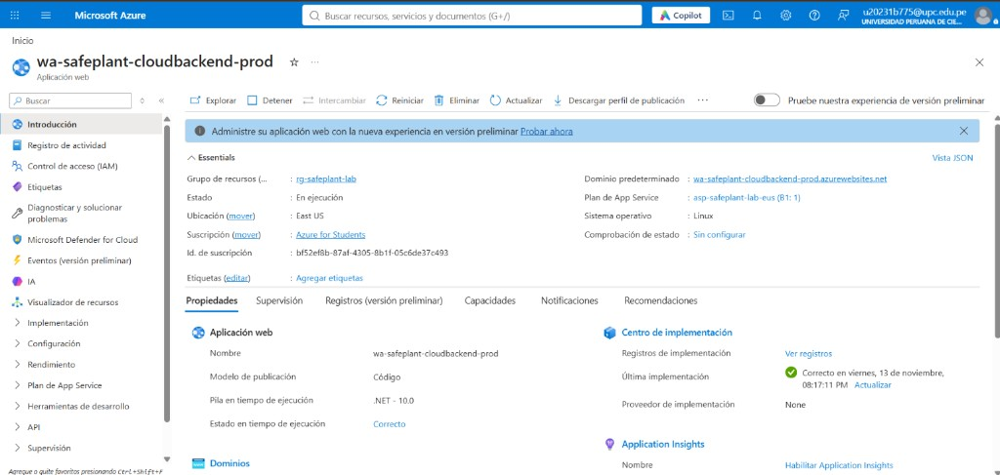

<a id="s-6-2-2-9"></a>
#### 6.2.2.9. Team Collaboration Insights during Sprint

La colaboración del Sprint 2 se midió sobre los repositorios de la organización con commits desde el 9 de octubre de 2026. Cada integrante asumió un frente de producto y un bloque del informe, de modo que el incremento —backend, web integrada, app móvil e IoT— quedó trazable en Git y en la documentación.

<table>
  <thead>
    <tr>
      <th align="left">Alumno</th>
      <th align="left">Actividad</th>
    </tr>
  </thead>
  <tbody>
    <tr>
      <td align="left">Solano Armas, Angelo Héctor</td>
      <td align="left">Encargado del desarrollo de la aplicación móvil del Supervisor de Seguridad. Implementó la sesión (inicio, cierre y recuperación de credenciales), el panel de seguridad, alertas, exposiciones, acciones, override y la configuración de planta (áreas, umbrales y dispositivos), alineando la app con el contrato de Cloud.Api. Ejecutó y documentó la suite de 296 pruebas Flutter. En el informe se encargó de 6.2.2.4 Development Evidence (móvil), 6.2.2.5 Testing Suite Evidence, 6.2.2.6 Execution Evidence (flujos móviles) y 6.2.2.8 Software Deployment Evidence (conexión del móvil con la API en Azure), además de la demo móvil del Video About-the-Product, el Final Project Keynote, el APK y las evidencias móviles del ZIP.</td>
    </tr>
    <tr>
      <td align="left">Gordillo Ramos, Santiago Alonso</td>
      <td align="left">Lideró la consolidación del Final Project Documentation Report para AV2. Actualizó el Registro de Versiones 3.x, Project Report Collaboration Insights y Student Outcome; corrigió artefactos previos y el diseño visual de la aplicación móvil (rama diseno/ui-movil). En el informe se encargó de 6.2.2.1 Sprint Planning 2, 6.2.2.2 Aspect Leaders and Collaborators, 6.2.2.3 Sprint Backlog 2, 6.2.2.9 Team Collaboration Insights during Sprint y aportó a 6.3.3 Evaluaciones según heurísticas con la revisión de diseño y hallazgos de interfaz.</td>
    </tr>
    <tr>
      <td align="left">Baldeon Vivar, Santiago Armando</td>
      <td align="left">Encargado de la validación con usuarios. Organizó y realizó las entrevistas de validación, preparó el guion y las preguntas, y registró respuestas, hallazgos y enlaces a las grabaciones. Definió el contrato MQTT del nodo ESP32 y documentó la evidencia del circuito IoT en Wokwi. En el informe se encargó de 6.3 Validation Interviews (6.3.1 Diseño de Entrevistas, 6.3.2 Registro de Entrevistas y aporte a 6.3.3 Evaluaciones según heurísticas) y de la sección de validación del Final Project Keynote.</td>
    </tr>
    <tr>
      <td align="left">Iglesias Pérez, Sergio Sebastián</td>
      <td align="left">Encargado del backend y de la integración de la aplicación web. Implementó los bounded contexts Plant Monitoring, Safety &amp; Actuation y Device &amp; Edge Management, con recepción de telemetría por MQTT, persistencia local en planta, Docker Compose y la API publicada en Azure App Service. Reemplazó los datos de muestra de la web por el consumo real de Cloud.Api. En el informe se encargó de 6.2.2.4 Development Evidence (backend), 6.2.2.6 Execution Evidence (Docker Compose), 6.2.2.7 Services Documentation Evidence (Swagger/OpenAPI) y 6.2.2.8 Software Deployment Evidence (API en Azure), además de la demo del backend en el Video About-the-Product y el Final Project Keynote.</td>
    </tr>
    <tr>
      <td align="left">Sanchez Gonzales, Gabriel</td>
      <td align="left">Encargado del componente IoT y del nodo de campo. Actualizó 5.1 Style Guidelines y documentó el flujo de telemetría por MQTT desde el ESP32 hacia Plant.Host y la nube. Preparó la evidencia del componente IoT en su entorno de prueba y los archivos del ZIP. En el informe se encargó de 6.2.2.4 Development Evidence (nodo y MQTT), 6.2.2.6 Execution Evidence (IoT) y de la demostración del componente IoT en el Video About-the-Product y el Final Project Keynote.</td>
    </tr>
  </tbody>
</table>

Las cifras de commits son reproducibles con `git shortlog -sn --since="2026-10-09" --all` y agrupan las identidades de Git de un mismo integrante.

| Integrante | `Report` | `landing-page` | `safeplant-web-client` | `safeplant-web-backend` | `App-Movil` | Total |
| :--- | ---: | ---: | ---: | ---: | ---: | ---: |
| Iglesias Pérez, Sergio Sebastián | 0 | 5 | 1 | 10 | 0 | 16 |
| Solano Armas, Angelo Héctor | 0 | 0 | 4 | 0 | 10 | 14 |
| Sanchez Gonzales, Gabriel | 1 | 0 | 5 | 0 | 7 | 13 |
| Gordillo Ramos, Santiago Alonso | 5 | 0 | 5 | 0 | 1 | 11 |
| Baldeon Vivar, Santiago Armando | 0 | 0 | 7 | 0 | 2 | 9 |
| **Total** | **6** | **5** | **22** | **10** | **20** | **63** |

Los tres compromisos propuestos en el Sprint 1 se cumplieron correctamente. El backend usa una rama feature/* por contexto y la app móvil tiene la rama diseno/ui-movil para el diseño visual. El de commits propios de todos los integrantes se cumplió.

**Repositorio Report**

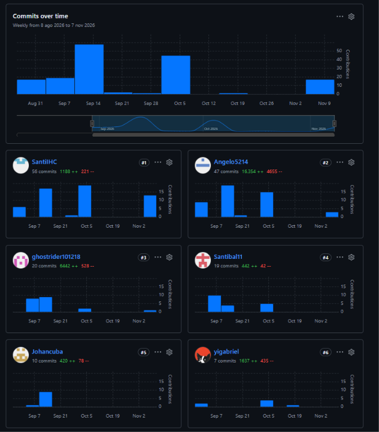

<a id="s-6-3"></a>
## 6.3. Validation Interviews

<a id="s-6-3-1"></a>
### 6.3.1. Diseño de Entrevistas

<a id="s-6-3-2"></a>
### 6.3.2. Registro de Entrevistas

<a id="s-6-3-3"></a>
### 6.3.3. Evaluaciones según heurísticas

---

**Navegación:** [Índice](./00-student-outcome.md#s-tabla-contenidos) · Anterior: [Capítulo V](./05-capitulo-v-solution-ui-ux-design.md) · Siguiente: [Conclusiones](./07-conclusiones.md)
